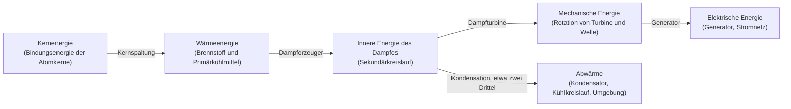
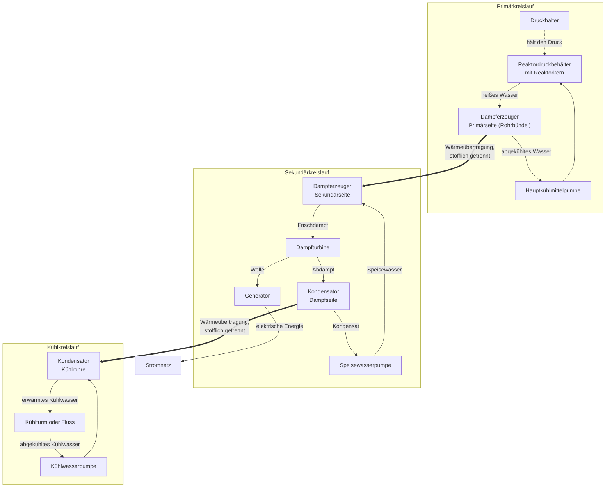
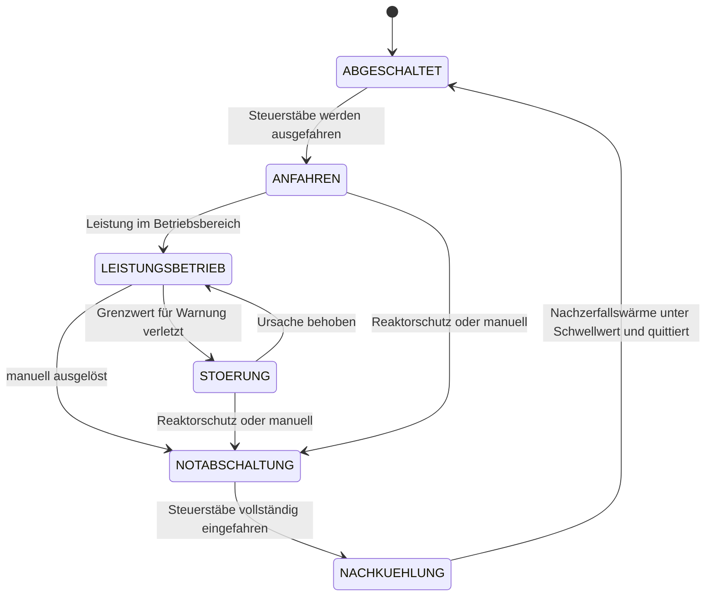
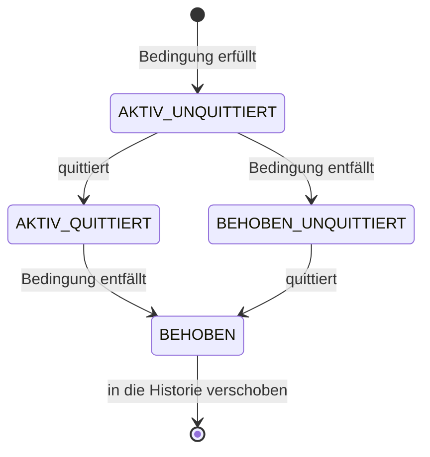
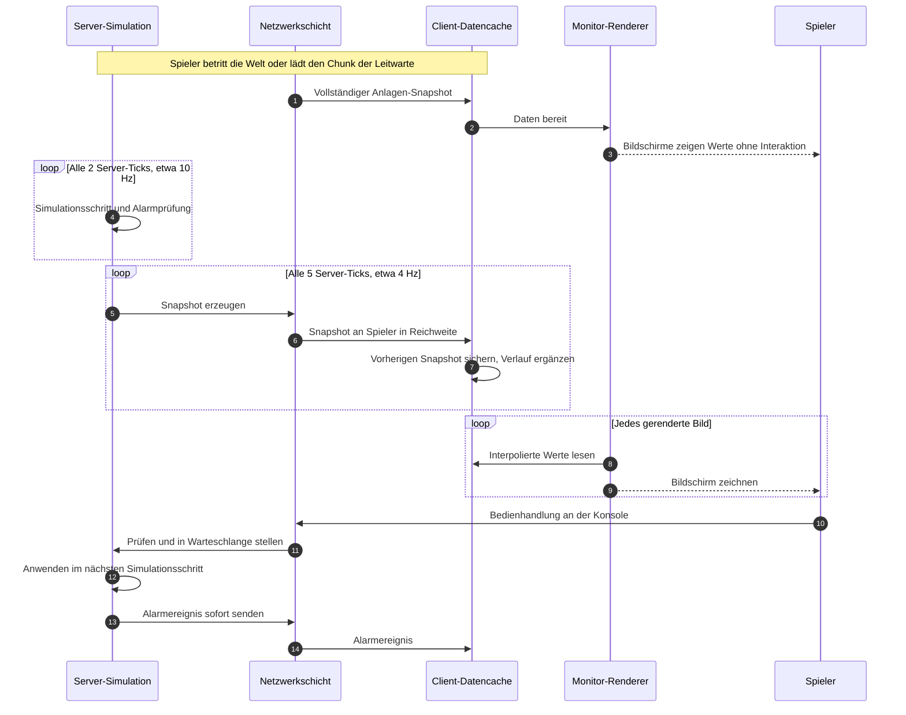
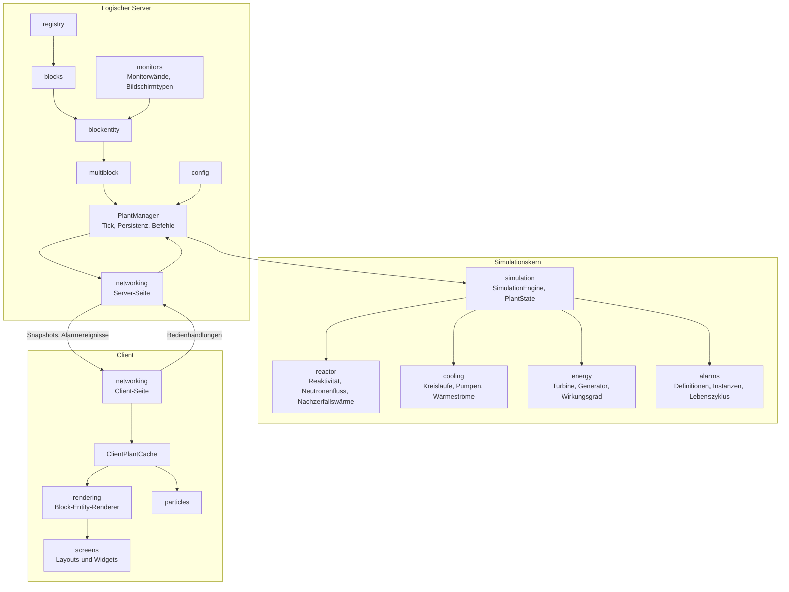
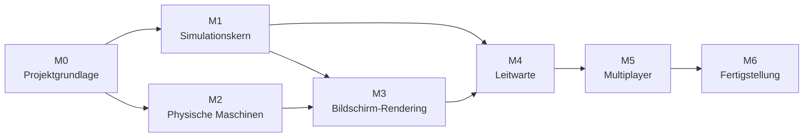

# Atomkraftwerke – Technische Projektspezifikation

Diese Datei ist die zentrale technische Referenz für die Entwicklung der Minecraft-Fabric-Mod **Atomkraftwerke**. Sie beschreibt Ziele, Anforderungen, wissenschaftliche Grundlagen, Simulationsmodell, Softwarearchitektur und Roadmap. Die Einstiegsseite des Repositories ist die [README](../README.md).

> [!IMPORTANT]
> **Status:** Planungsphase. Nichts in diesem Dokument ist bereits implementiert. Klassennamen, Pakete, Parameter und Zahlenwerte sind **Vorschläge** und werden bei der Umsetzung überprüft.
>
> **Didaktischer Charakter:** Die Simulation ist ein vereinfachtes Lehrmodell für den Schulunterricht. Sie ist **kein** validierter Reaktorsimulator und vermittelt **keine** Bedienung realer kerntechnischer Anlagen.

### Kennzeichnung in diesem Dokument

| Kennzeichnung | Bedeutung |
|---|---|
| **Illustrativ** | Frei gewählter Beispielwert für die Mod, physikalisch plausibel, aber nicht aus einer realen Anlage übernommen |
| **Typische Größenordnung** | Gerundeter Wert, wie er bei realen Druckwasserreaktoren üblich ist; dient nur zur Einordnung |
| **Vereinfacht** | Gleichung oder Modell, das die reale Physik bewusst stark reduziert |
| **Vorschlag** | Architektur- oder Gestaltungsentscheidung, die noch bestätigt werden muss |
| **Offen** | Entscheidung, die noch nicht getroffen wurde (siehe [Abschnitt 18](#18-offene-technische-entscheidungen)) |

---

## Inhaltsverzeichnis

1. [Projektziele](#1-projektziele)
2. [Funktionale Anforderungen](#2-funktionale-anforderungen)
3. [Nicht-funktionale Anforderungen](#3-nicht-funktionale-anforderungen)
4. [Wissenschaftliche Grundlagen](#4-wissenschaftliche-grundlagen)
5. [Reaktorarchitektur: Druckwasserreaktor](#5-reaktorarchitektur-druckwasserreaktor)
6. [Simulationsmodell](#6-simulationsmodell)
7. [Monitor- und Rendering-Architektur](#7-monitor--und-rendering-architektur)
8. [UI-Designsystem](#8-ui-designsystem)
9. [Bediensysteme und Interaktion](#9-bediensysteme-und-interaktion)
10. [Alarmmanagement](#10-alarmmanagement)
11. [Multiblock-System](#11-multiblock-system)
12. [Multiplayer-Architektur](#12-multiplayer-architektur)
13. [Performance-Anforderungen](#13-performance-anforderungen)
14. [Softwarearchitektur und Java-Paketstruktur](#14-softwarearchitektur-und-java-paketstruktur)
15. [Entwicklungs-Roadmap](#15-entwicklungs-roadmap)
16. [MVP-Umfang](#16-mvp-umfang)
17. [Zukünftige Erweiterungen](#17-zukünftige-erweiterungen)
18. [Offene technische Entscheidungen](#18-offene-technische-entscheidungen)
19. [Teststrategie](#19-teststrategie)
20. [Videokonzept](#20-videokonzept)
21. [Glossar](#21-glossar)

---

## 1. Projektziele

### 1.1 Ausgangslage

| Punkt | Beschreibung |
|---|---|
| Projektname | Atomkraftwerke |
| Projekttyp | Minecraft Java Edition Fabric-Mod |
| Sprache | Java |
| Anlass | Chemie-Schulprojekt, 9. Klasse |
| Begleitmedium | Minecraft-Video, etwa 2–6 Minuten |
| Technisches Vorbild | Druckwasserreaktor (DWR, englisch Pressurized Water Reactor, PWR) |
| Abhängigkeiten | Nur Fabric Loader und Fabric API; keine verpflichtenden Gameplay- oder Technik-Mods |

### 1.2 Ziele

| Nr. | Ziel |
|---|---|
| Z1 | Die Funktionsweise eines Kernkraftwerks mit Druckwasserreaktor anschaulich und fachlich korrekt erklären. |
| Z2 | Die Energieumwandlung von der Kernspaltung bis zur elektrischen Energie sichtbar machen. |
| Z3 | Die drei Wasserkreisläufe und ihre Trennung verständlich darstellen. |
| Z4 | Sicherheitsrelevante Vorgänge wie Notabschaltung und Nachzerfallswärme didaktisch demonstrieren. |
| Z5 | Eine glaubwürdige, begehbare Anlage mit Leitwarte und physischen Bildschirmen in Minecraft bereitstellen. |
| Z6 | Eine Grundlage für ein 2–6-minütiges Erklärvideo schaffen. |
| Z7 | Eine saubere, testbare Architektur aufbauen, die mit Claude Code schrittweise erweitert werden kann. |

### 1.3 Nicht-Ziele

- Kein ingenieurwissenschaftlich validierter Reaktorsimulator.
- Keine Anleitung zum Betrieb realer Anlagen.
- Keine Darstellung von Kernschmelze, Explosionen oder Strahlenschäden.
- Keine Science-Fiction-Technik (Fusionsreaktoren, Hologramme, futuristische Waffen).
- Keine Integration in Energiesysteme anderer Mods im ersten Entwicklungsstand.

---

## 2. Funktionale Anforderungen

Die Priorität richtet sich nach dem [MVP-Umfang](#16-mvp-umfang): **P1** = MVP-Pflicht, **P2** = empfohlen, **P3** = optional.

### 2.1 Simulation

| ID | Anforderung | Priorität |
|---|---|---|
| F-SIM-01 | Die Mod simuliert den Zustand eines Reaktors mit relativem Neutronenfluss, thermischer Leistung, Kerntemperatur und Kühlmitteldruck. | P1 |
| F-SIM-02 | Die Position der Steuerstäbe beeinflusst die Reaktivität und damit die Leistung. | P1 |
| F-SIM-03 | Eine negative Temperaturrückkopplung stabilisiert die Leistung. | P1 |
| F-SIM-04 | Primär-, Sekundär- und Kühlkreislauf werden als gekoppelte Wärmeströme modelliert. | P1 |
| F-SIM-05 | Die elektrische Leistung ergibt sich aus der übertragenen Wärme und einem Wirkungsgrad. | P1 |
| F-SIM-06 | Nach einer Notabschaltung wird Nachzerfallswärme weiter erzeugt und abklingend dargestellt. | P1 |
| F-SIM-07 | Hauptkühlmittelpumpen können einzeln ausfallen und laufen dabei verzögert aus. | P1 |
| F-SIM-08 | Ein vereinfachter Reaktorschutz löst bei Grenzwertverletzungen automatisch eine Notabschaltung aus. | P1 |
| F-SIM-09 | Ein einstellbarer Zeitraffer erlaubt, langsame Vorgänge im Video in kurzer Zeit zu zeigen. | P1 |
| F-SIM-10 | Störfallszenarien können gezielt ausgelöst werden (z. B. per Befehl für Operatoren). | P1 |
| F-SIM-11 | Borsäurekonzentration im Primärkühlmittel als zusätzliche Reaktivitätssteuerung. | P3 |
| F-SIM-12 | Xenonvergiftung und Abbrand. | P3 |

### 2.2 Anlage und Welt

| ID | Anforderung | Priorität |
|---|---|---|
| F-WLD-01 | Eigene Blöcke für Reaktorkomponenten, Kreislaufkomponenten, Monitore und Konsolen. | P1 |
| F-WLD-02 | Der Reaktordruckbehälter ist eine Multiblock-Struktur mit Strukturerkennung. | P1 |
| F-WLD-03 | Dampferzeuger, Turbine, Generator und Kühlturm als Multiblock-Strukturen. | P2 |
| F-WLD-04 | Eigene 3D-Modelle (Blockbench) und Texturen, vollständig in der Mod enthalten. | P1 |
| F-WLD-05 | Dampfschwaden am Kühlturm als Partikeleffekt. | P2 |
| F-WLD-06 | Akustische Warnsignale in der Leitwarte. | P2 |

### 2.3 Bildschirme

| ID | Anforderung | Priorität |
|---|---|---|
| F-MON-01 | Monitore sind platzierbare Blöcke; der Inhalt wird direkt auf die 3D-Bildschirmfläche gerendert. | P1 |
| F-MON-02 | Inhalte sind nach dem Laden der Welt ohne Interaktion sichtbar. | P1 |
| F-MON-03 | Benachbarte Monitore gleicher Ausrichtung bilden eine Monitorwand mit einem gemeinsamen Bild. | P1 |
| F-MON-04 | Jeder Monitor zeigt einen von sieben Bildschirmtypen (siehe [7.6](#76-bildschirmtypen)). | P1 (4 Typen), P2 (alle 7) |
| F-MON-05 | Inhalte aktualisieren sich bei Änderungen der Simulation; alle Spieler sehen dieselben Werte. | P1 |
| F-MON-06 | Trendkurven zeigen den zeitlichen Verlauf ausgewählter Messwerte. | P2 |

### 2.4 Bedienung und Alarme

| ID | Anforderung | Priorität |
|---|---|---|
| F-CTL-01 | Bedienkonsolen erlauben das Ein- und Ausfahren der Steuerstäbe. | P1 |
| F-CTL-02 | Eine geschützte Taste löst die Notabschaltung aus. | P1 |
| F-CTL-03 | Hauptkühlmittelpumpen und Kühlwasserpumpen können gestartet und gestoppt werden. | P1 |
| F-CTL-04 | Alarme können quittiert werden. | P1 |
| F-CTL-05 | Alle Bedienhandlungen werden serverseitig validiert. | P1 |
| F-ALM-01 | Zentrales Alarmmanagement mit den Stufen `NORMAL`, `INFO`, `WARNING`, `CRITICAL`, `SHUTDOWN`. | P1 |
| F-ALM-02 | Alarme erscheinen automatisch auf den zugehörigen Monitoren. | P1 |
| F-ALM-03 | Alarmhistorie mit Zeitstempeln. | P2 |
| F-ALM-04 | Blinkende Anzeige für unquittierte kritische Alarme. | P2 |

### 2.5 Multiplayer und Speicherung

| ID | Anforderung | Priorität |
|---|---|---|
| F-MP-01 | Der Server ist autoritativ für den Simulationszustand. | P1 |
| F-MP-02 | Der Simulationszustand wird mit der Welt gespeichert und nach einem Neustart wiederhergestellt. | P1 |
| F-MP-03 | Die Mod funktioniert im Einzelspieler (integrierter Server) und auf einem dedizierten Server. | P1 |

---

## 3. Nicht-funktionale Anforderungen

| ID | Kategorie | Anforderung |
|---|---|---|
| NF-01 | Fachliche Korrektheit | Wissenschaftliche Aussagen sind belegbar; vereinfachte Gleichungen und illustrative Werte sind gekennzeichnet. |
| NF-02 | Eigenständigkeit | Keine Pflichtabhängigkeiten außer Fabric Loader und Fabric API. Alle Assets sind in der Mod-JAR enthalten. |
| NF-03 | Performance | Simulation, Synchronisierung und Rendering bleiben innerhalb der Budgets aus [Abschnitt 13](#13-performance-anforderungen). |
| NF-04 | Multiplayer-Konsistenz | Alle Clients zeigen denselben Zustand; Abweichungen sind höchstens so groß wie ein Synchronisierungsintervall. |
| NF-05 | Testbarkeit | Der Simulationskern ist ohne laufendes Minecraft mit Unit-Tests prüfbar. |
| NF-06 | Wartbarkeit | Modulare Pakete mit klaren Verantwortlichkeiten (siehe [Abschnitt 14](#14-softwarearchitektur-und-java-paketstruktur)). |
| NF-07 | Lesbarkeit | Bildschirme sind aus normaler Spielerentfernung und in einer Videoaufnahme gut lesbar. |
| NF-08 | Sprache | Texte in der Mod auf Deutsch (`de_de`); Englisch (`en_us`) ist eine offene Entscheidung. |
| NF-09 | Robustheit | Ungültige Netzwerkpakete und Bedienhandlungen werden verworfen, ohne den Server zu beeinträchtigen. |
| NF-10 | Determinismus | Gleicher Anfangszustand und gleiche Eingaben führen zum gleichen Simulationsverlauf. |
| NF-11 | Verantwortung | Keine Darstellung, die reale unsichere Bedienhandlungen nahelegt oder Unfälle sensationell inszeniert. |

---

## 4. Wissenschaftliche Grundlagen

Dieser Abschnitt erklärt die Fachinhalte, die die Mod vermittelt. Er dient zugleich als Prüfgrundlage für Texte auf Bildschirmen und im Video.

### 4.1 Chemische Reaktion und Kernreaktion

Da es sich um ein Chemie-Projekt handelt, ist diese Unterscheidung zentral:

| Merkmal | Chemische Reaktion | Kernreaktion |
|---|---|---|
| Beteiligter Teil des Atoms | Elektronenhülle | Atomkern |
| Was sich ändert | Bindungen zwischen Atomen | Zusammensetzung der Kerne (Protonen, Neutronen) |
| Chemische Elemente | bleiben erhalten | können sich umwandeln (z. B. Uran → Barium + Krypton) |
| Energie pro Einzelreaktion | einige Elektronenvolt (eV) | Millionen Elektronenvolt (MeV) |
| Beispiel | Verbrennung von Kohlenstoff: C + O₂ → CO₂ (ca. 4 eV pro Kohlenstoffatom) | Spaltung von U-235: rund 200 MeV pro Spaltung |
| Massenerhaltung | gilt in sehr guter Näherung | messbarer Massendefekt, $E = \Delta m \cdot c^2$ |

Pro Einzelreaktion setzt eine Kernspaltung damit etwa **50 Millionen Mal** so viel Energie frei wie die Verbrennung eines Kohlenstoffatoms (200 MeV ÷ 4 eV).

### 4.2 Uran und Isotope

- Uran hat die Ordnungszahl 92 (92 Protonen). Isotope desselben Elements unterscheiden sich in der Neutronenzahl.
- Natürliches Uran besteht zu etwa **99,3 % aus U-238** und zu etwa **0,7 % aus U-235**.
- Nur U-235 ist mit langsamen (thermischen) Neutronen gut spaltbar.
- Brennstoff für Druckwasserreaktoren wird auf **typischerweise 3–5 % U-235 angereichert** (typische Größenordnung).
- Der Brennstoff liegt chemisch als **Urandioxid (UO₂)** vor, gepresst und gesintert zu Tabletten (Pellets), die in Hüllrohre aus einer Zirkoniumlegierung gefüllt werden. Diese **Brennstäbe** werden zu **Brennelementen** gebündelt.

> Hinweis für die Mod: Die im Auftrag genannten „Uran-235-Brennelemente“ werden in Texten korrekt als **Brennelemente mit angereichertem Uran** bezeichnet, da sie überwiegend U-238 enthalten.

### 4.3 Kernspaltung

Trifft ein langsames Neutron auf einen U-235-Kern, entsteht kurzzeitig ein angeregter U-236-Kern, der sich in zwei mittelschwere Kerne (Spaltprodukte) teilt. Ein mögliches Beispiel unter vielen:

```math
{}^{235}_{92}\mathrm{U} + {}^{1}_{0}\mathrm{n} \rightarrow {}^{236}_{92}\mathrm{U}^{*} \rightarrow {}^{141}_{56}\mathrm{Ba} + {}^{92}_{36}\mathrm{Kr} + 3\,{}^{1}_{0}\mathrm{n}
```

Massenzahlen (235 + 1 = 141 + 92 + 3) und Ordnungszahlen (92 = 56 + 36) bleiben erhalten. Es entstehen sehr viele verschiedene Spaltproduktpaare; im Mittel werden etwa **2–3 Neutronen** pro Spaltung frei.

Die freigesetzte Energie von rund **200 MeV** stammt aus dem Massendefekt: Die Produkte sind zusammen etwas leichter als die Ausgangsstoffe. Der größte Teil der Energie liegt zunächst als Bewegungsenergie der Spaltprodukte vor und wird im Brennstoff durch Stöße in **Wärme** umgewandelt.

### 4.4 Kettenreaktion und Steuerung

Die frei werdenden Neutronen können weitere Kerne spalten. Für die Steuerung ist entscheidend, wie viele Neutronen einer Generation in der nächsten Generation wieder eine Spaltung auslösen. Das beschreibt der **effektive Multiplikationsfaktor** $k_{\mathrm{eff}}$:

| Zustand | Bedingung | Bedeutung |
|---|---|---|
| unterkritisch | $k_{\mathrm{eff}} < 1$ | Kettenreaktion klingt ab |
| kritisch | $k_{\mathrm{eff}} = 1$ | konstante Leistung (stationärer Betrieb) |
| überkritisch | $k_{\mathrm{eff}} > 1$ | Leistung steigt |

Die Abweichung von der Kritikalität wird als **Reaktivität** $\rho = (k_{\mathrm{eff}} - 1)/k_{\mathrm{eff}}$ angegeben.

Wichtige Mechanismen:

- **Moderation:** Schnelle Neutronen müssen abgebremst werden, damit sie U-235 effizient spalten. Im Druckwasserreaktor übernimmt **dasselbe Wasser** die Aufgaben von Moderator und Kühlmittel.
- **Absorption:** Neutronen werden von Steuerstäben, Borsäure im Kühlmittel, U-238 und Spaltprodukten eingefangen, ohne eine Spaltung auszulösen.
- **Verzögerte Neutronen:** Ein kleiner Anteil (bei U-235 unter 1 %) der Neutronen wird erst Sekunden bis Minuten nach der Spaltung von Spaltprodukten abgegeben. Erst dadurch ist ein Reaktor regelbar.
- **Negative Temperaturrückkopplung:** Steigt die Temperatur, nimmt die Reaktivität ab (unter anderem, weil wärmeres Wasser eine geringere Dichte hat und schlechter moderiert, und durch den Doppler-Effekt im Brennstoff). Druckwasserreaktoren sind so ausgelegt, dass dieser Effekt die Leistung stabilisiert.

> Die geringe Anreicherung von Reaktorbrennstoff schließt eine nukleare Explosion wie bei einer Kernwaffe physikalisch aus. Andere schwere Unfallabläufe wie eine Kernschmelze sind bei realen Anlagen möglich, werden in der Mod aber bewusst nicht dargestellt.

### 4.5 Steuerstäbe und Brennelemente

| Merkmal | Brennelement | Steuerstab |
|---|---|---|
| Aufgabe | enthält den spaltbaren Brennstoff, erzeugt Wärme | absorbiert Neutronen, regelt die Kettenreaktion |
| Material | Urandioxid in Hüllrohren aus Zirkoniumlegierung | Neutronenabsorber, z. B. Silber-Indium-Cadmium oder Borcarbid (B₄C) |
| Wirkung beim Einfahren | – | Reaktivität sinkt, Leistung sinkt |
| Position | fest im Kern | beweglich, beim DWR von oben eingefahren |
| Notabschaltung | – | fallen durch Schwerkraft innerhalb weniger Sekunden vollständig ein |

Zusätzlich wird beim realen DWR **Borsäure (H₃BO₃)** im Primärkühlmittel gelöst. Das Isotop B-10 absorbiert Neutronen; über die Konzentration wird die Reaktivität langfristig eingestellt. In der Mod ist das eine optionale Erweiterung (F-SIM-11).

### 4.6 Thermische und elektrische Leistung

| Größe | Formelzeichen | Einheit | Bedeutung |
|---|---|---|---|
| Thermische Leistung | $P_{\mathrm{th}}$ | MW (MW_th) | im Reaktorkern freigesetzte Wärmeleistung |
| Elektrische Leistung | $P_{\mathrm{el}}$ | MW (MW_el) | vom Generator abgegebene elektrische Leistung |
| Abwärme | $P_{\mathrm{ab}}$ | MW | über Kondensator und Kühlkreislauf an die Umgebung abgegebene Wärme |
| Wirkungsgrad | $\eta$ | – | Anteil der thermischen Leistung, der zu elektrischer Leistung wird |

Bei realen Druckwasserreaktoren liegt der Gesamtwirkungsgrad in der **typischen Größenordnung von etwa einem Drittel**. Rund zwei Drittel der Wärme werden also als Abwärme abgegeben. Bildschirme in der Mod geben deshalb immer an, ob eine Leistung **thermisch** oder **elektrisch** ist.

### 4.7 Kettenreaktion und Nachzerfallswärme

| Merkmal | Kettenreaktion (Spaltleistung) | Nachzerfallswärme |
|---|---|---|
| Ursache | Kernspaltung durch Neutronen | radioaktiver Zerfall der Spaltprodukte (vor allem Beta- und Gammazerfall) |
| Durch Steuerstäbe abschaltbar | ja | **nein** |
| Anteil im Leistungsbetrieb | Hauptanteil | einige Prozent |
| Verlauf nach Abschaltung | fällt rasch stark ab | klingt über Stunden bis Jahre langsam ab |

Nach einer Notabschaltung beträgt die Nachzerfallswärme unmittelbar danach in der Größenordnung von **etwa 6–7 %** der vorherigen thermischen Leistung, nach einer Stunde noch etwa **1 %**, nach einem Tag einige Zehntel Prozent (typische Größenordnung nach langem Betrieb). Bei einer Anlage mit mehreren Tausend Megawatt thermischer Leistung sind das auch nach Stunden noch viele Megawatt. Deshalb muss der Reaktor nach der Abschaltung **weiter gekühlt** werden (Nachkühlung).

Eine empirische Näherung für den Verlauf ist die **Way-Wigner-Formel** (vereinfacht):

```math
\frac{P_{\mathrm{NZ}}(t)}{P_0} \approx 0{,}0622 \cdot \left[ t^{-0{,}2} - (t + T)^{-0{,}2} \right]
```

mit $t$ = Zeit seit der Abschaltung in Sekunden, $T$ = vorherige Betriebszeit in Sekunden, $P_0$ = thermische Leistung vor der Abschaltung. Die Formel ist eine grobe Näherung und dient in der Mod nur als **Referenzkurve für Tests** (siehe [19.2](#192-unit-tests-des-simulationskerns)).

### 4.8 Energieumwandlung



Vereinfachte Berechnung der elektrischen Leistung:

```math
P_{\mathrm{el}} = P_{\mathrm{th}} \cdot \eta
```

| Formelzeichen | Bedeutung |
|---|---|
| $P_{\mathrm{el}}$ | elektrische Leistung |
| $P_{\mathrm{th}}$ | thermische Leistung |
| $\eta$ | Gesamtwirkungsgrad (Turbinenprozess und Generator) |

**Illustratives Rechenbeispiel** (keine reale Anlage):

| Größe | Wert |
|---|---|
| $P_{\mathrm{th}}$ | 3000 MW |
| $\eta$ | 0,33 |
| $P_{\mathrm{el}} = 3000\ \mathrm{MW} \cdot 0{,}33$ | 990 MW |
| $P_{\mathrm{ab}} = P_{\mathrm{th}} - P_{\mathrm{el}}$ | 2010 MW |

---

## 5. Reaktorarchitektur: Druckwasserreaktor

### 5.1 Prinzip

Im Druckwasserreaktor erhitzt der Reaktorkern Wasser, das unter so hohem Druck steht, dass es **nicht siedet**. Dieses Wasser gibt seine Wärme im **Dampferzeuger** an einen zweiten Wasserkreislauf ab, in dem Dampf für die Turbine entsteht. Ein dritter Kreislauf führt die verbleibende Wärme aus dem Kondensator an die Umgebung ab.

### 5.2 Die drei Wasserkreisläufe



**Kernaussage:** Primär- und Sekundärkreislauf sind im Dampferzeuger **thermisch gekoppelt, aber stofflich getrennt**. Das Primärwasser fließt durch Tausende dünne Rohre, die Wärme geht durch die Rohrwand auf das Sekundärwasser über, ohne dass sich die beiden Wassermengen mischen. Deshalb ist der Dampf in der Turbine im Normalbetrieb nicht radioaktiv. Dasselbe Prinzip trennt im Kondensator den Sekundärkreislauf vom Kühlkreislauf.

### 5.3 Komponenten

#### Primärkreislauf

| Komponente | Aufgabe |
|---|---|
| Reaktordruckbehälter (RDB) | dickwandiger Stahlbehälter, der Reaktorkern und Primärkühlmittel unter hohem Druck einschließt |
| Reaktorkern | Anordnung der Brennelemente und Steuerstäbe; hier wird durch Kernspaltung Wärme frei |
| Primärkühlmittel | Wasser unter hohem Druck; kühlt den Kern und moderiert die Neutronen |
| Hauptkühlmittelpumpen | wälzen das Primärkühlmittel um; reale Anlagen haben mehrere Kühlschleifen mit je einer Pumpe |
| Druckhalter | Behälter mit Wasser- und Dampfpolster, der den Druck über elektrische Heizer und Sprühwasser regelt |
| Dampferzeuger (Primärseite) | Rohrbündel, durch das das heiße Primärwasser strömt und seine Wärme abgibt |

#### Sekundärkreislauf

| Komponente | Aufgabe |
|---|---|
| Dampferzeuger (Sekundärseite) | Speisewasser verdampft an den heißen Rohren |
| Dampfturbine | wandelt die Energie des Dampfes in Rotationsenergie um |
| Generator | wandelt Rotationsenergie durch elektromagnetische Induktion in elektrische Energie um |
| Kondensator | kondensiert den Abdampf bei sehr niedrigem Druck wieder zu Wasser |
| Speisewassersystem | pumpt das Kondensat als Speisewasser zurück in den Dampferzeuger |

#### Kühlkreislauf

| Komponente | Aufgabe |
|---|---|
| Kondensator (Kühlrohre) | Kühlwasser nimmt die Kondensationswärme auf |
| Kühlwasserpumpe | fördert das Kühlwasser |
| Kühlturm | gibt die Wärme an die Luft ab (Naturzugkühlturm: vor allem durch Verdunstung) |
| Alternative: Flusswasserkühlung | Kühlwasser wird einem Fluss entnommen und erwärmt zurückgegeben |

> Die sichtbare Wolke über einem Kühlturm besteht aus kondensiertem Wasserdampf des Kühlkreislaufs. Sie kommt nicht aus dem Primärkreislauf und ist nicht radioaktiv. Dieser häufige Irrtum eignet sich gut für das Video.

### 5.4 Typische Betriebswerte

Die folgenden Werte sind **typische Größenordnungen** realer Druckwasserreaktoren, stark gerundet. Die Mod verwendet daran angelehnte **illustrative** Werte (siehe [6.8](#68-illustrative-parameter)).

| Größe | Typische Größenordnung |
|---|---|
| Druck im Primärkreislauf | etwa 150–160 bar |
| Temperatur Primärkühlmittel am Kerneintritt | etwa 290 °C |
| Temperatur Primärkühlmittel am Kernaustritt | etwa 320–330 °C |
| Siedetemperatur von Wasser bei 155 bar | etwa 345 °C (daher siedet das Primärwasser nicht) |
| Frischdampf im Sekundärkreislauf | etwa 60–70 bar, etwa 280 °C |
| Druck im Kondensator | deutlich unter 0,1 bar (Unterdruck) |
| Gesamtwirkungsgrad | etwa 33–35 % |

### 5.5 Abbildung in Minecraft

| Reale Komponente | Darstellung in der Mod (Vorschlag) |
|---|---|
| Reaktorgebäude (Sicherheitsbehälter) | vom Spieler gebaut, rein dekorativ (Kuppel oder Zylinder) |
| Reaktordruckbehälter mit Kern | Multiblock mit Controller-Block |
| Brennelemente | Komponentenblöcke im RDB-Multiblock |
| Steuerstabantriebe | Komponentenblöcke oberhalb des RDB |
| Hauptkühlmittelpumpen | einzelne Blöcke mit Block Entity (MVP), später Multiblock |
| Druckhalter | einzelner Block oder kleiner Multiblock |
| Dampferzeuger | Multiblock (P2), im MVP einzelner Block |
| Turbine und Generator | Multiblock (P2), im MVP einzelne Blöcke |
| Kondensator | einzelner Block |
| Kühlturm | Multiblock oder dekorative Struktur mit Partikelquelle (P2) |
| Rohrleitungen | dekorative Rohrblöcke ohne eigene Strömungssimulation |
| Leitwarte | Monitorblöcke, Konsolenblöcke, dekorative Möbel |

Rohrleitungen sind bewusst **dekorativ**: Die Strömung wird im Simulationskern berechnet, nicht über Blockverbindungen. Das hält das Modell einfach und unabhängig vom Bau des Spielers.

---

## 6. Simulationsmodell

### 6.1 Modellansatz

Das Modell ist ein **konzentriertes Parametermodell** (englisch lumped-parameter model): Der gesamte Reaktor wird durch wenige Zustandsgrößen beschrieben, ohne räumliche Verteilung. Alle Gleichungen sind **vereinfacht** und die Parameter **illustrativ**. Ziel ist qualitativ richtiges Verhalten (richtige Richtung, plausible Größenordnung, richtige zeitliche Abfolge), nicht quantitative Genauigkeit.

### 6.2 Zustandsgrößen

| Größe | Symbol | Feld (Vorschlag) | Einheit | Wertebereich |
|---|---|---|---|---|
| Einfahrgrad der Steuerstäbe | $h$ | `rodInsertion` | – | 0 (ausgefahren) bis 1 (vollständig eingefahren) |
| Sollwert Steuerstäbe | $h_{\mathrm{soll}}$ | `rodTarget` | – | 0 bis 1 |
| Reaktivität | $\rho$ | `reactivity` | – (illustrative Einheit) | begrenzt |
| Relativer Neutronenfluss | $n$ | `neutronFlux` | – | 0 bis $n_{\max}$; 1,0 = Nennleistung |
| Nachzerfallsleistung (Gruppen) | $P_i$ | `decayHeatGroups[]` | MW | ≥ 0 |
| Kerntemperatur | $T_{\mathrm{K}}$ | `coreTemperature` | °C | begrenzt |
| Mittlere Primärkühlmitteltemperatur | $T_{\mathrm{P}}$ | `primaryTemperature` | °C | begrenzt |
| Primärdruck | $p_{\mathrm{P}}$ | `primaryPressure` | bar | begrenzt |
| Drehzahl Hauptkühlmittelpumpe i | $\omega_i$ | `pumpSpeed[i]` | – | 0 bis 1 |
| Sekundärtemperatur | $T_{\mathrm{S}}$ | `secondaryTemperature` | °C | begrenzt |
| Drehzahl Kühlwasserpumpe | $\omega_{\mathrm{KW}}$ | `coolingPumpSpeed` | – | 0 bis 1 |
| Betriebszustand | – | `mode` | Enum | siehe [6.6](#66-betriebszustände) |
| Simulationszeit | $t$ | `simulationTime` | s | ≥ 0 |

Abgeleitete Größen (nicht gespeichert, pro Schritt berechnet): thermische Leistung, Wärmeströme, mechanische und elektrische Leistung, Abwärme, Primärdurchfluss.

### 6.3 Gleichungen

Alle Gleichungen sind **vereinfacht**. Die Parameter sind in [6.8](#68-illustrative-parameter) zusammengefasst.

**Reaktivität**

```math
\rho = w \cdot (h_{\mathrm{krit}} - h) + \alpha_T \cdot (T_{\mathrm{K}} - T_{\mathrm{ref}})
```

- $w$: Reaktivitätswert der Steuerstäbe (illustrativ, linear statt der realen S-förmigen Kennlinie).
- $h_{\mathrm{krit}}$: Einfahrgrad, bei dem der Reaktor bei Referenztemperatur kritisch ist.
- $\alpha_T < 0$: Temperaturkoeffizient; erzeugt die stabilisierende negative Rückkopplung.

**Neutronenfluss** (stark vereinfachte Kinetik mit einer effektiven Zeitkonstante statt der Punktkinetik mit verzögerten Neutronengruppen)

```math
\frac{dn}{dt} = \frac{\rho}{\tau_{\mathrm{eff}}} \cdot n + S_0
```

- $\tau_{\mathrm{eff}}$: effektive Zeitkonstante, die das durch verzögerte Neutronen gedämpfte Verhalten nachahmt.
- $S_0$: kleine Neutronenquelle, damit der Fluss im abgeschalteten Zustand nicht exakt null wird.

**Thermische Leistung** (Spaltleistung plus Nachzerfallswärme)

```math
P_{\mathrm{th}} = (1 - a) \cdot n \cdot P_{\mathrm{nenn}} + \sum_i P_i,
\qquad
\frac{dP_i}{dt} = \frac{a_i \cdot n \cdot P_{\mathrm{nenn}} - P_i}{\tau_i},
\qquad a = \sum_i a_i
```

Im stationären Betrieb gilt $P_{\mathrm{th}} = n \cdot P_{\mathrm{nenn}}$. Fällt $n$ nach einer Notabschaltung ab, klingen die Gruppen $P_i$ mit ihren Zeitkonstanten $\tau_i$ ab. Drei Gruppen mit Zeitkonstanten von Sekunden, Minuten und Stunden reichen für einen plausiblen Verlauf; die Parameter werden gegen die Way-Wigner-Referenzkurve aus [4.7](#47-kettenreaktion-und-nachzerfallswärme) abgestimmt.

**Durchfluss und Wärmeübergang**

```math
\dot m_{\mathrm{P}} = \max\!\left(\frac{1}{N}\sum_{i=1}^{N} \omega_i,\ \dot m_{\mathrm{nat}}\right),
\qquad
f(\dot m) = \dot m^{\,0{,}8}
```

- $\dot m_{\mathrm{P}}$: relativer Primärdurchfluss (1,0 = Nenndurchfluss).
- $\dot m_{\mathrm{nat}}$: kleiner Restdurchfluss durch Naturumlauf (illustrativ).
- $f$: Faktor für den Wärmeübergang; der Exponent 0,8 ist an empirische Korrelationen für turbulente Strömung angelehnt und hier nur qualitativ gemeint.

**Temperaturen** (Wärmebilanzen mit Wärmekapazitäten $C$ und Übertragungskoeffizienten $k$)

```math
\begin{aligned}
Q_{\mathrm{KP}} &= k_{\mathrm{KP}} \cdot f(\dot m_{\mathrm{P}}) \cdot (T_{\mathrm{K}} - T_{\mathrm{P}}) \\
Q_{\mathrm{DE}} &= k_{\mathrm{DE}} \cdot f(\dot m_{\mathrm{P}}) \cdot (T_{\mathrm{P}} - T_{\mathrm{S}}) \\
Q_{\mathrm{ab}} &= k_{\mathrm{S}} \cdot f(\dot m_{\mathrm{KW}}) \cdot (T_{\mathrm{S}} - T_{\mathrm{KW}}) \\[4pt]
C_{\mathrm{K}} \frac{dT_{\mathrm{K}}}{dt} &= P_{\mathrm{th}} - Q_{\mathrm{KP}} \\
C_{\mathrm{P}} \frac{dT_{\mathrm{P}}}{dt} &= Q_{\mathrm{KP}} - Q_{\mathrm{DE}} \\
C_{\mathrm{S}} \frac{dT_{\mathrm{S}}}{dt} &= Q_{\mathrm{DE}} - Q_{\mathrm{ab}}
\end{aligned}
```

- $Q_{\mathrm{KP}}$: Wärmestrom vom Kern ins Primärkühlmittel.
- $Q_{\mathrm{DE}}$: Wärmestrom im Dampferzeuger vom Primär- in den Sekundärkreislauf.
- $Q_{\mathrm{ab}}$: Wärmestrom, den Turbine und Kondensator dem Sekundärkreislauf entziehen.
- $T_{\mathrm{KW}}$: Kühlwassertemperatur (Parameter).

Fällt der Kühlkreislauf aus, sinkt $Q_{\mathrm{ab}}$, $T_{\mathrm{S}}$ steigt, dadurch sinkt $Q_{\mathrm{DE}}$ und $T_{\mathrm{P}}$ steigt. Die Störung pflanzt sich also physikalisch plausibel vom Kühlkreislauf bis zum Reaktor fort.

**Energieumwandlung**

```math
P_{\mathrm{mech}} = \eta_{\mathrm{T}} \cdot Q_{\mathrm{ab}},
\qquad
P_{\mathrm{el}} = \eta_{\mathrm{G}} \cdot P_{\mathrm{mech}},
\qquad
P_{\mathrm{Abwärme}} = Q_{\mathrm{ab}} - P_{\mathrm{mech}}
```

Im stationären Zustand gilt $Q_{\mathrm{ab}} = P_{\mathrm{th}}$ und damit $P_{\mathrm{el}} = P_{\mathrm{th}} \cdot \eta$ mit $\eta = \eta_{\mathrm{T}} \cdot \eta_{\mathrm{G}}$. Ist die Turbine abgeschaltet, wird $Q_{\mathrm{ab}}$ vereinfacht vollständig als Abwärme abgeführt (entspricht einer Umleitung des Dampfes am Kondensator vorbei).

**Primärdruck** (vereinfacht)

```math
p_{\mathrm{P}} = p_{\mathrm{soll}} + \beta_p \cdot (T_{\mathrm{P}} - T_{\mathrm{P,soll}}) - \Delta p_{\mathrm{DH}}
```

$\Delta p_{\mathrm{DH}}$ ist die Korrektur des Druckhalters, die mit einer Zeitkonstante dem Sollwert nachgeführt wird und nur begrenzt wirkt.

**Hauptkühlmittelpumpen**

Laufende Pumpen fahren mit begrenzter Rate auf den Sollwert. Bei Ausfall laufen sie verzögert aus, wie reale Pumpen mit Schwungmasse:

```math
\frac{d\omega_i}{dt} = -\frac{\omega_i}{\tau_{\mathrm{Auslauf}}}
```

**Steuerstäbe**

Im Normalbetrieb bewegen sich die Stäbe mit begrenzter Geschwindigkeit $v_{\mathrm{Stab}}$ auf $h_{\mathrm{soll}}$. Bei einer Notabschaltung gilt $h \rightarrow 1$ innerhalb weniger Sekunden Simulationszeit.

### 6.4 Numerik

| Punkt | Vorschlag |
|---|---|
| Verfahren | explizites Euler-Verfahren mit festem Zeitschritt |
| Zeitschritt | $\Delta t = 0{,}1\ \mathrm{s}$ Simulationszeit pro Simulationsschritt bei Zeitraffer 1× |
| Unterschritte | bei Zeitraffer > 1× wird der Schritt in Unterschritte $\le \Delta t_{\max}$ zerlegt, damit das Verfahren stabil bleibt |
| Begrenzung | alle Zustandsgrößen werden nach jedem Schritt auf ihren Wertebereich begrenzt |
| Prüfung | `NaN` oder `Infinity` führen zu einem Rücksetzen auf den letzten gültigen Zustand und einer Fehlermeldung im Log |
| Determinismus | keine Zufallszahlen ohne festen Startwert, keine Abhängigkeit von der Bildrate |

### 6.5 Zeitraffer

Reale Vorgänge laufen teils sehr langsam ab (Nachzerfallswärme über Stunden). Für ein Video von 2–6 Minuten ist ein **Zeitraffer** nötig.

- Faktor einstellbar, z. B. 1× bis 60× (Vorschlag).
- Jeder Bildschirm zeigt in der Statusleiste die **Simulationszeit** und den **Zeitrafferfaktor**, damit der Zuschauer nicht über die realen Zeitskalen getäuscht wird.
- Der Faktor wirkt nur auf die Simulationszeit, nicht auf die Minecraft-Tageszeit.

### 6.6 Betriebszustände



| Zustand | Enum-Wert (Vorschlag) | Beschreibung |
|---|---|---|
| Abgeschaltet | `SHUTDOWN` | Reaktor unterkritisch, Steuerstäbe eingefahren, Temperaturen niedrig |
| Anfahren | `STARTUP` | Steuerstäbe werden ausgefahren, Leistung steigt |
| Leistungsbetrieb | `POWER_OPERATION` | stationärer Betrieb zwischen Teillast und Nennleistung |
| Störung | `ABNORMAL` | mindestens eine Warnung aktiv, Reaktor noch in Betrieb |
| Notabschaltung | `SCRAM` | Reaktorschnellabschaltung (RESA) läuft, Steuerstäbe fallen ein |
| Nachkühlung | `DECAY_HEAT_REMOVAL` | Reaktor abgeschaltet, Nachzerfallswärme wird abgeführt |

Der Betriebszustand ist vom **Alarmstatus** ([Abschnitt 10](#10-alarmmanagement)) zu unterscheiden: Der Betriebszustand beschreibt die Anlage, der Alarmstatus die höchste aktive Meldung.

### 6.7 Reaktorschutz (vereinfacht)

Reale Anlagen besitzen ein Reaktorschutzsystem, das bei Grenzwertverletzungen automatisch abschaltet. Die Mod bildet das stark vereinfacht nach:

| Auslösekriterium (illustrativ) | Wirkung |
|---|---|
| Kerntemperatur über Grenzwert | automatische Notabschaltung |
| Primärdurchfluss unter Grenzwert bei Leistung über einem Mindestwert | automatische Notabschaltung |
| Primärdruck über Grenzwert | automatische Notabschaltung |
| Manuelle Notabschaltung an der Konsole | Notabschaltung |

**Vorschlag:** Der Reaktorschutz ist in der Mod **immer aktiv** und nicht abschaltbar. Die Simulation erreicht dadurch nie Zustände jenseits von `CRITICAL` mit anschließender Notabschaltung. Kernschädigung wird nicht modelliert.

### 6.8 Illustrative Parameter

Alle Werte sind **illustrativ** und werden bei der Umsetzung so abgestimmt, dass sich das gewünschte qualitative Verhalten ergibt. Sie gehören in eine Konfigurationsdatei oder eine Konstantenklasse.

| Parameter | Symbol | Illustrativer Startwert |
|---|---|---|
| Nennleistung thermisch | $P_{\mathrm{nenn}}$ | 3000 MW |
| Gesamtwirkungsgrad | $\eta = \eta_{\mathrm{T}} \cdot \eta_{\mathrm{G}}$ | 0,33 (z. B. 0,34 · 0,98 ≈ 0,33) |
| Sollwert Primärdruck | $p_{\mathrm{soll}}$ | 155 bar |
| Sollwert mittlere Primärtemperatur | $T_{\mathrm{P,soll}}$ | 310 °C |
| Referenztemperatur Kern | $T_{\mathrm{ref}}$ | bei Abstimmung festzulegen |
| Kühlwassertemperatur | $T_{\mathrm{KW}}$ | 20 °C |
| Anzahl Hauptkühlmittelpumpen | $N$ | 4 |
| Restdurchfluss Naturumlauf | $\dot m_{\mathrm{nat}}$ | 0,05 |
| Anteil Nachzerfallswärme im Betrieb | $a$ | 0,065 |
| Übrige Konstanten ($w, h_{\mathrm{krit}}, \alpha_T, \tau_{\mathrm{eff}}, C, k, \beta_p, \tau_i, \tau_{\mathrm{Auslauf}}$) | – | bei Abstimmung festzulegen |

### 6.9 Störfallszenarien

Szenarien können über einen Operator-Befehl (Vorschlag: `/akw szenario <name>`) oder über eine Szenariokonsole ausgelöst werden. Sie dienen der Demonstration im Unterricht und im Video.

| Szenario | Auslöser | Erwarteter Verlauf (qualitativ) | Typische Alarme |
|---|---|---|---|
| Normalbetrieb | Ausgangszustand | stabile Leistung, alle Werte im Normalbereich | keine |
| Reduzierter Kühlmittelfluss | Pumpendrehzahl wird reduziert | Primärtemperatur steigt, negative Rückkopplung senkt die Leistung leicht | `COOLANT_FLOW_WARNING` |
| Ausfall einer Kühlmittelpumpe | eine Pumpe fällt aus | Pumpe läuft aus, Durchfluss sinkt auf etwa drei Viertel, Temperaturen steigen | `COOLANT_PUMP_TRIP`, `COOLANT_FLOW_WARNING` |
| Steigende Reaktortemperatur | Folge verminderter Kühlung | Kerntemperatur nähert sich dem Grenzwert | `REACTOR_TEMPERATURE_WARNING`, dann `REACTOR_TEMPERATURE_CRITICAL` |
| Einfahren der Steuerstäbe | Bediener fährt Stäbe ein | Reaktivität sinkt, Leistung sinkt kontrolliert | `INFO`-Meldung zur Leistungsänderung |
| Notabschaltung | manuell oder Reaktorschutz | Stäbe fallen ein, Spaltleistung bricht ein, Turbine wird abgeschaltet | `EMERGENCY_SHUTDOWN` |
| Nachzerfallswärme | folgt der Notabschaltung | thermische Leistung bleibt einige Prozent über null und klingt langsam ab | `DECAY_HEAT_REMOVAL_ACTIVE` |
| Wiederherstellung der Kühlung | Pumpe wird wieder gestartet | Durchfluss steigt, Temperaturen sinken, Alarme gehen in „behoben“ über | `COOLING_RESTORED` |

### 6.10 Was das Modell nicht abbildet

Die folgenden Aspekte realer Reaktorphysik und -technik werden **bewusst nicht** oder nur stark vereinfacht simuliert:

| Bereich | Nicht abgebildet |
|---|---|
| Neutronenphysik | Neutronentransport, räumliche Flussverteilung, Energiespektrum der Neutronen, einzelne Gruppen verzögerter Neutronen, prompte Kritikalität |
| Brennstoff | Abbrand, Isotopenzusammensetzung, Plutoniumbildung, Xenon- und Samariumvergiftung (Xenon optional als Erweiterung) |
| Thermohydraulik | Zweiphasenströmung, Strömungsverteilung im Kern, Siedekrise, reale Stoffwerte von Wasser und Dampf |
| Mechanik | Materialbelastung, Versprödung, Schwingungen, reale Pumpenkennlinien |
| Sicherheitstechnik | redundante Sicherheitssysteme, Notstromversorgung, Notkühlsysteme, Sicherheitsbehälter, Leittechniklogik realer Anlagen |
| Unfallabläufe | Kernschmelze, Wasserstoffbildung, Freisetzung radioaktiver Stoffe |
| Strahlenschutz | Dosisleistung, Kontamination, Abschirmung |
| Netz | Netzfrequenz, Lastverteilung, Netzanbindung |

---

## 7. Monitor- und Rendering-Architektur

### 7.1 Anforderungen

Die Bildschirme sind eine Kernfunktion der Mod. Sie sind **physische Blöcke in der Welt** und keine GUIs, Inventarfenster oder HUD-Overlays.

| Anforderung | Umsetzung (Vorschlag) |
|---|---|
| platzierbarer Block | `MonitorBlock` mit horizontaler Ausrichtung |
| Inhalt direkt auf der Bildschirmfläche | `BlockEntityRenderer` zeichnet im Weltkoordinatensystem auf die Vorderseite |
| sofort sichtbar, ohne Interaktion | Renderer läuft automatisch, sobald der Chunk geladen ist; Daten kommen per Initialsynchronisierung |
| dynamische Inhalte | Renderer liest aus einem clientseitigen Datencache, der per Netzwerk aktualisiert wird |
| verschiedene Typen | Bildschirmtyp als Eigenschaft der Block Entity, Layout pro Typ |
| synchronisiert für alle Spieler | Server sendet denselben Anlagenzustand an alle betroffenen Clients |

### 7.2 Bestandteile

| Bestandteil | Seite | Aufgabe |
|---|---|---|
| `MonitorBlock` | gemeinsam | Block, Ausrichtung, Platzierung, Abbau, Auslösen der Monitorwand-Bildung |
| `MonitorBlockEntity` | gemeinsam | speichert Anlagen-ID, Bildschirmtyp und Zugehörigkeit zur Monitorwand; **keine** Simulationslogik |
| `MonitorWall` | gemeinsam | rechteckige Gruppe von Monitoren gleicher Ausrichtung; ein Master-Monitor (z. B. unten links) rendert die ganze Fläche |
| `ClientPlantCache` | Client | hält für jede Anlage den aktuellen und den vorherigen Snapshot sowie Verlaufsdaten für Kurven |
| `MonitorBlockEntityRenderer` | Client | zeichnet Hintergrund, Panels, Texte, Balken und Kurven |
| `ScreenLayout` (je Typ) | Client | beschreibt, welche Widgets wo auf dem Bildschirm liegen |
| Widgets | Client | wiederverwendbare Elemente: Messwertkachel, Balken, Trendkurve, Prozessschema, Alarmliste, Statusleiste |

### 7.3 Rendering-Ablauf

1. Der Renderer prüft, ob die Block Entity Master einer Monitorwand ist. Nur der Master zeichnet.
2. Transformation auf die Vorderseite: Verschiebung zur Blockfläche, Drehung nach Ausrichtung, kleiner Abstand vor der Fläche gegen Z-Fighting.
3. Skalierung auf ein virtuelles Pixelraster (Vorschlag: 64 oder 128 virtuelle Pixel pro Block), damit Layouts auflösungsunabhängig sind.
4. Zeichnen mit **voller Helligkeit** (selbstleuchtend), damit Bildschirme auch in dunklen Räumen lesbar sind.
5. Werte werden zwischen dem vorherigen und dem aktuellen Snapshot interpoliert, damit Anzeigen trotz niedriger Synchronisierungsrate ruhig wirken.
6. Liegen noch keine Daten vor, zeigt der Bildschirm „Keine Daten – Verbindung wird hergestellt“.

### 7.4 Rendering-Techniken

| Technik | Beschreibung | Vorteile | Nachteile |
|---|---|---|---|
| A: Direktes Zeichnen | Rechtecke, Linien und Text werden in jedem Frame mit den Vertex-Puffern der Welt gezeichnet | einfach, scharf, keine Texturverwaltung | Kosten pro Frame wachsen mit der Anzahl der Elemente |
| B: Dynamische Textur | Bildschirminhalt wird in eine Textur gezeichnet, die nur bei neuen Daten aktualisiert wird | sehr günstig pro Frame | Texturverwaltung, Auflösung begrenzt, Text weniger scharf |
| C: Eigenes Render-Ziel | Inhalt wird in einen eigenen Framebuffer gerendert | flexibel | am aufwendigsten, stark versionsabhängig |

**Vorschlag:** Technik A für das MVP, mit Zwischenspeichern aller formatierten Texte und Geometrie, die sich nur bei neuen Daten ändern. Technik B als Option für Trendkurven, falls Profiling Bedarf zeigt. Die Entscheidung ist **offen** bis zum ersten Prototyp in M3.

> Die Rendering-Schnittstellen von Minecraft haben sich zwischen Versionen mehrfach deutlich geändert. Konkrete Klassen und Methoden werden erst nach der Festlegung der Minecraft-Version (siehe [Abschnitt 18](#18-offene-technische-entscheidungen)) bestimmt.

### 7.5 Sichtbarkeit und Renderdistanz

- Block-Entity-Renderer haben eine begrenzte Standard-Renderdistanz. Für große Monitorwände muss sie gegebenenfalls erhöht und der Render-Begrenzungsrahmen auf die ganze Wand erweitert werden.
- **Detailstufen** (Vorschlag): Ab einer bestimmten Entfernung zeigt der Bildschirm nur Hintergrund, Titel und Statusfarbe; Texte und Kurven entfallen.
- Monitore außerhalb des Sichtfelds werden durch das Frustum-Culling von Minecraft nicht gezeichnet.

### 7.6 Bildschirmtypen

| Nr. | Bildschirmtyp | Enum-Wert (Vorschlag) | Inhalte | MVP |
|---|---|---|---|---|
| 1 | Reaktorübersicht | `REACTOR_OVERVIEW` | Prozessschema aller drei Kreisläufe, Betriebszustand, $P_{\mathrm{th}}$, $P_{\mathrm{el}}$, höchster Alarm | ja |
| 2 | Reaktorkernüberwachung | `REACTOR_CORE` | relativer Neutronenfluss, Reaktivität, Steuerstabposition, Kerntemperatur, Nachzerfallswärme, Trendkurve | optional |
| 3 | Primärkreislauf | `PRIMARY_LOOP` | Pumpenstatus und -drehzahlen, Durchfluss, Druck, Ein- und Austrittstemperatur, Druckhalter | ja |
| 4 | Sekundärkreislauf | `SECONDARY_LOOP` | Dampferzeuger, Dampftemperatur, Speisewasser, Kondensator, Kühlwasser | optional |
| 5 | Turbine und Generator | `TURBINE_GENERATOR` | Turbinenstatus, mechanische Leistung, elektrische Leistung, Wirkungsgrad | optional |
| 6 | Alarm- und Warnungsübersicht | `ALARMS` | aktive Alarme nach Schweregrad, Zeitstempel, Quittierstatus, Historie | ja |
| 7 | Stromerzeugung | `POWER_GENERATION` | Energieflussdiagramm (thermisch → elektrisch, Abwärme), Leistungskurve, Wirkungsgrad | ja |

### 7.7 Darstellungsinhalte

| Widget | Zweck |
|---|---|
| Messwertkachel | Bezeichnung, Wert mit Einheit, Statusfarbe, optional Tendenzpfeil |
| Balkenanzeige | Wert relativ zu Normalbereich und Grenzwerten |
| Trendkurve | Verlauf eines Messwerts über die letzten Minuten Simulationszeit |
| Prozessschema | vereinfachtes Fließbild; Leitungen und Komponenten in Statusfarben |
| Alarmliste | Zeitstempel, Schweregrad, Titel, Zustand |
| Energieflussdiagramm | Aufteilung der thermischen Leistung in elektrische Leistung und Abwärme |
| Statusleiste | Anlagenname, Betriebszustand, Simulationszeit, Zeitrafferfaktor |

**Zahlenformat:** Deutsches Format mit Dezimalkomma und schmalem Tausendertrenner, z. B. „2 970,4 MW“. Leistungen immer mit Zusatz „thermisch“ oder „elektrisch“.

---

## 8. UI-Designsystem

### 8.1 Grundsätze

- Übersichtlich, gut lesbar, technisch glaubwürdig; Vorbild sind moderne Leitwarten mit Prozessvisualisierung.
- Ruhige Grundfläche: Im Normalbetrieb dominieren Grau und Blau; Farbe signalisiert Abweichungen.
- Status wird nie **nur** über Farbe vermittelt, sondern zusätzlich über Text oder Symbol (Barrierefreiheit und Lesbarkeit im komprimierten Video).
- Vermieden werden übermäßige Farbverläufe, Neon-Effekte, Hologramme, futuristische Elemente und dekorative Animationen.

### 8.2 Farbpalette

Die Hex-Werte sind ein **Vorschlag** und werden im Spiel auf Lesbarkeit geprüft.

| Token (Vorschlag) | Element | Farbe | Hex |
|---|---|---|---|
| `BACKGROUND` | Hintergrund | Dunkles Anthrazit | `#1B1F23` |
| `PANEL` | Panels | Dunkelgrau | `#2A2F35` |
| `PANEL_BORDER` | Panelrahmen, Trennlinien | Grau | `#3A4047` |
| `ACCENT` | Akzent, Leitungen, Auswahl | Kühles Blau | `#4A90C2` |
| `TEXT_PRIMARY` | Haupttext | Weiß | `#FFFFFF` |
| `TEXT_SECONDARY` | Sekundärtext, Einheiten | Hellgrau | `#B8BEC6` |
| `STATUS_NORMAL` | Normalbetrieb | Grün | `#4CAF50` |
| `STATUS_WARNING` | Warnungen | Orange | `#F0A030` |
| `STATUS_CRITICAL` | Kritische Alarme | Rot | `#E04040` |
| `STATUS_INFO` | Informationen | Blau (wie Akzent) | `#4A90C2` |

### 8.3 Layout

| Bereich | Inhalt |
|---|---|
| Kopfzeile | Bildschirmtitel, Anlagenname, Betriebszustand |
| Inhaltsbereich | Raster aus Panels mit Widgets |
| Fußzeile | höchster aktiver Alarm, Simulationszeit, Zeitrafferfaktor |

- Raster auf Basis des virtuellen Pixelrasters (siehe [7.3](#73-rendering-ablauf)) mit einheitlichen Abständen.
- Schrift: Minecraft-Standardschrift (unterstützt deutsche Umlaute). Hierarchie über Skalierung: Titel, Messwert, Beschriftung.
- Messwerte rechtsbündig, Einheiten in Sekundärtextfarbe.

### 8.4 Zustandsdarstellung

| Zustand | Darstellung |
|---|---|
| Normal | Wert in Haupttextfarbe, kleiner grüner Statusindikator |
| Information | blauer Indikator, Meldung in der Alarmliste |
| Warnung | orangefarbener Indikator und Rahmen um das Widget |
| Kritisch, unquittiert | roter Rahmen, blinkt mit etwa 1 Hz (funktional begründet, keine Dekoration) |
| Kritisch, quittiert | roter Rahmen, dauerhaft |
| Notabschaltung | Kopfzeile rot hinterlegt mit Text „NOTABSCHALTUNG“ |
| Keine Daten | grauer Hinweistext, keine Messwerte |

---

## 9. Bediensysteme und Interaktion

### 9.1 Trennung von Überwachung und Steuerung

| Funktion | Blöcke | Interaktion |
|---|---|---|
| **Überwachung** | Monitorblöcke, Statusanzeigen | keine; nur Anzeige. Konfiguration (Bildschirmtyp, Anlagen-Zuordnung) über ein Werkzeug |
| **Steuerung** | Konsolenblöcke | Bedienhandlungen, die serverseitig geprüft und auf die Simulation angewendet werden |

### 9.2 Konsolentypen

| Konsole | Bedienelemente |
|---|---|
| Reaktorsteuerkonsole | Steuerstäbe einfahren, ausfahren, Sollwert; Anzeige der Stabposition |
| Notabschaltung | geschützte Taste mit Schutzkappe; Rücksetzen nach Notabschaltung |
| Kühlkreislaufsteuerung | Kühlwasserpumpe starten und stoppen |
| Pumpensteuerung | Hauptkühlmittelpumpen einzeln starten, stoppen, Drehzahl einstellen |
| Alarmkonsole | einzelne Alarme oder alle quittieren, Hupe stummschalten |
| Überwachungsstation | nur Anzeige, keine Bedienung |
| Szenariokonsole (Operator) | Störfallszenarien auslösen und zurücksetzen |

### 9.3 Bedienablauf

1. Der Spieler klickt mit Rechtsklick auf ein Bedienelement auf der Konsolenoberfläche.
2. Der Client ermittelt aus der Trefferposition auf der Blockfläche das Bedienelement.
3. Der Client sendet ein Paket `ControlActionPayload` mit Anlagen-ID, Konsolenposition, Aktion und gegebenenfalls Wert.
4. Der Server prüft die Bedienhandlung (siehe [9.4](#94-serverseitige-validierung)).
5. Gültige Aktionen werden in eine Befehlswarteschlange der Anlage gestellt und **im nächsten Simulationsschritt** angewendet.
6. Die Rückmeldung (z. B. Tastenbeleuchtung, Stabposition) erscheint über den nächsten Snapshot auf allen Clients.

Die Schutzkappe der Notabschaltung erfordert zwei Klicks: Kappe öffnen, dann Taste drücken. Das verhindert versehentliches Auslösen.

### 9.4 Serverseitige Validierung

| Prüfung | Beschreibung |
|---|---|
| Entfernung | Spieler befindet sich in Interaktionsreichweite der Konsole |
| Block | an der Position steht eine Konsole des passenden Typs |
| Zuordnung | Konsole gehört zur angegebenen Anlage |
| Aktion | Aktion ist für diesen Konsolentyp erlaubt |
| Wertebereich | Werte liegen im zulässigen Bereich (z. B. Stabsollwert 0 bis 1) |
| Verriegelung | z. B. kein Ausfahren der Steuerstäbe während einer aktiven Notabschaltung |
| Berechtigung | konfigurierbar: alle Spieler oder nur Operatoren (**offen**) |
| Ratenbegrenzung | höchstens eine bestimmte Anzahl von Aktionen pro Spieler und Sekunde |

### 9.5 Aktionen (Vorschlag)

| Aktion | Parameter |
|---|---|
| `ROD_INSERT_STEP`, `ROD_WITHDRAW_STEP` | – |
| `ROD_SET_TARGET` | Sollwert 0–1 |
| `SCRAM_COVER_TOGGLE`, `SCRAM_TRIGGER`, `SCRAM_RESET` | – |
| `PRIMARY_PUMP_START`, `PRIMARY_PUMP_STOP` | Pumpennummer |
| `PRIMARY_PUMP_SET_SPEED` | Pumpennummer, Drehzahl 0–1 |
| `COOLING_PUMP_START`, `COOLING_PUMP_STOP` | – |
| `ALARM_ACKNOWLEDGE` | Alarm-ID |
| `ALARM_ACKNOWLEDGE_ALL`, `HORN_SILENCE` | – |

---

## 10. Alarmmanagement

### 10.1 Schweregrade

| Status | Bedeutung | Reihenfolge |
|---|---|---|
| `NORMAL` | Normalbetrieb, kein Alarm aktiv | 0 |
| `INFO` | Information, keine Handlung nötig | 1 |
| `WARNING` | Warnung, Wert außerhalb des Normalbereichs | 2 |
| `CRITICAL` | kritischer Zustand, Grenzwert überschritten | 3 |
| `SHUTDOWN` | Notabschaltung aktiv | 4 |

Der **Gesamtstatus** einer Anlage ist der höchste Schweregrad aller aktiven Alarme, oder `NORMAL`, wenn keiner aktiv ist.

### 10.2 Datenmodell

**Alarmdefinition** (statisch, einmal registriert):

| Eigenschaft | Beschreibung |
|---|---|
| `id` | eindeutige ID, z. B. `COOLANT_FLOW_WARNING` |
| `severity` | Schweregrad |
| `system` | zugehöriges Anlagensystem: `REACTOR`, `PRIMARY_LOOP`, `SECONDARY_LOOP`, `TURBINE_GENERATOR`, `COOLING`, `SAFETY` |
| `titleKey`, `descriptionKey` | Übersetzungsschlüssel für Titel und Beschreibung |
| Bedingung | Prüffunktion auf den Simulationszustand |
| Hysterese | Abstand zwischen Auslöse- und Rücksetzschwelle |
| Ansprechverzögerung | Mindestdauer, bevor der Alarm auslöst |

**Alarminstanz** (zur Laufzeit):

| Eigenschaft | Beschreibung |
|---|---|
| Alarm-ID | Verweis auf die Definition |
| Zeitstempel ausgelöst | Simulationszeit |
| Zeitstempel behoben | Simulationszeit oder leer |
| Zustand | siehe [10.3](#103-lebenszyklus) |
| quittiert von | Spielername oder leer (optional) |

### 10.3 Lebenszyklus



Hysterese und Ansprechverzögerung verhindern ein schnelles Flattern zwischen aktiv und behoben.

### 10.4 Alarmkatalog

Schwellen sind **illustrativ** und werden mit den Simulationsparametern abgestimmt.

| ID | Schweregrad | System | Bedingung (qualitativ) | Beschreibung |
|---|---|---|---|---|
| `COOLANT_FLOW_WARNING` | `WARNING` | `PRIMARY_LOOP` | Primärdurchfluss unter Normalbereich | „Primärkühlmittelfluss unterhalb des normalen Betriebsbereichs.“ |
| `COOLANT_PUMP_TRIP` | `WARNING` | `PRIMARY_LOOP` | eine Hauptkühlmittelpumpe ausgefallen | „Hauptkühlmittelpumpe ausgefallen. Pumpe läuft aus.“ |
| `STEAM_GENERATOR_WARNING` | `WARNING` | `SECONDARY_LOOP` | Wärmestrom im Dampferzeuger deutlich unter Erwartung | „Wärmeübertragung im Dampferzeuger nimmt ab.“ |
| `PRIMARY_PRESSURE_HIGH` | `WARNING` | `PRIMARY_LOOP` | Primärdruck über Normalbereich | „Primärdruck oberhalb des normalen Betriebsbereichs.“ |
| `CONDENSER_COOLING_WARNING` | `WARNING` | `COOLING` | Kühlwasserdurchfluss zu gering | „Kühlung des Kondensators unzureichend.“ |
| `REACTOR_TEMPERATURE_WARNING` | `WARNING` | `REACTOR` | Kerntemperatur über Normalbereich | „Reaktortemperatur oberhalb des normalen Betriebsbereichs.“ |
| `REACTOR_TEMPERATURE_CRITICAL` | `CRITICAL` | `REACTOR` | Kerntemperatur über Simulationsgrenzwert | „Reaktortemperatur überschreitet den festgelegten Simulationsgrenzwert.“ |
| `EMERGENCY_SHUTDOWN` | `SHUTDOWN` | `SAFETY` | Notabschaltung ausgelöst | „Notabschaltung aktiviert. Steuerstäbe vollständig eingefahren.“ |
| `TURBINE_TRIP` | `INFO` | `TURBINE_GENERATOR` | Turbine abgeschaltet | „Turbine abgeschaltet. Keine elektrische Leistung.“ |
| `DECAY_HEAT_REMOVAL_ACTIVE` | `INFO` | `REACTOR` | Zustand Nachkühlung | „Nachkühlung aktiv. Nachzerfallswärme wird abgeführt.“ |
| `COOLING_RESTORED` | `INFO` | `PRIMARY_LOOP` | Durchfluss wieder im Normalbereich | „Kühlmittelfluss wiederhergestellt.“ |

`EMERGENCY_SHUTDOWN` wird ausgelöst, sobald die Notabschaltung beginnt. Der Zusatz „vollständig eingefahren“ wird angezeigt, wenn $h = 1$ erreicht ist.

### 10.5 Verteilung auf Monitore

- Jeder Bildschirmtyp abonniert ein oder mehrere Anlagensysteme. Aktive Alarme dieser Systeme erscheinen in seiner Fußzeile und an den betroffenen Widgets.
- Die Alarm- und Warnungsübersicht zeigt alle Alarme.
- Die Reaktorübersicht zeigt immer den höchsten aktiven Alarm.

### 10.6 Optionale Funktionen

| Funktion | Beschreibung |
|---|---|
| Akustische Signale | Hupe in der Leitwarte bei neuen `WARNING`/`CRITICAL`/`SHUTDOWN`-Alarmen; stummschaltbar; nur in der Nähe der Leitwarte hörbar |
| Blinkende Anzeigen | unquittierte kritische Alarme blinken |
| Alarmhistorie | begrenzte Liste der letzten behobenen Alarme (Vorschlag: 100 Einträge), wird mitgespeichert |
| Quittierung | einzeln oder gesammelt an der Alarmkonsole |

---

## 11. Multiblock-System

### 11.1 Ziel

Große Maschinen wie Reaktordruckbehälter, Dampferzeuger, Turbine, Generator und Kühlanlagen bestehen aus mehreren Blöcken. Das Multiblock-System erkennt gültige Strukturen und verwaltet ihren Zustand.

### 11.2 Strukturdefinition

| Bestandteil | Beschreibung |
|---|---|
| Muster | relative Positionen zum Controller-Block mit erlaubten Blöcken je Position |
| Pflichtkomponenten | Komponenten, die mindestens vorhanden sein müssen (z. B. Anzahl Brennelementblöcke) |
| Ausrichtung | Muster wird entsprechend der Ausrichtung des Controllers gedreht |
| Größenbegrenzung | maximale Ausdehnung, damit Prüfungen günstig bleiben |

### 11.3 Bildung und Auflösung

| Ereignis | Ablauf |
|---|---|
| Controller wird platziert | Controller prüft das Muster |
| Block in der Struktur wird platziert oder abgebaut | betroffener Controller wird zur erneuten Prüfung markiert |
| Prüfung | höchstens einmal pro Tick und Controller, nicht dauerhaft in jedem Tick |
| Struktur gültig | Controller speichert die Mitgliederpositionen, Mitglieder speichern die Controllerposition, Blockzustand `formed = true` |
| Struktur ungültig | Zuordnung wird aufgelöst, Simulation erhält die Meldung „Komponente fehlt“ |
| Chunk teilweise nicht geladen | Prüfung wird verschoben, bis alle betroffenen Chunks geladen sind; bestehender Zustand bleibt erhalten |

### 11.4 Maschinenzustand

| Zustand | Bedeutung |
|---|---|
| `INCOMPLETE` | Muster nicht erfüllt |
| `FORMED` | Struktur gültig, Maschine mit Simulation verbunden |
| `INVALID` | Struktur war gültig und wurde beschädigt |

Der Maschinenzustand fließt in die Simulation ein. Beispiel: Ein unvollständiger Reaktordruckbehälter verhindert das Anfahren.

### 11.5 Darstellung

Ist die Struktur gebildet, kann der Controller ein großes Gesamtmodell rendern und die Mitglieder ihr Einzelmodell ausblenden (über den Blockzustand `formed`). Dafür muss der Render-Begrenzungsrahmen auf die ganze Struktur erweitert werden.

### 11.6 Zuordnung zur Anlage

Jede Maschine, jeder Monitor und jede Konsole gehört zu genau einer Anlage (Anlagen-ID).

| Variante | Beschreibung |
|---|---|
| A: eine Anlage pro Welt | alle Blöcke gehören automatisch zur einzigen Anlage; einfachste Lösung |
| B: Verknüpfungswerkzeug | Spieler verbindet Blöcke mit einem Werkzeug mit dem Reaktor-Controller |
| C: automatische Zuordnung | Blöcke verbinden sich mit dem nächsten Controller in einem Radius |

**Vorschlag:** Variante A für das MVP, Datenmodell aber mit Anlagen-ID, damit B später möglich ist. Entscheidung **offen**.

### 11.7 Performance

- Keine Musterprüfung in jedem Tick; nur ereignisgesteuert.
- Mitgliederlisten werden gespeichert, nicht bei jedem Laden neu gesucht.
- Keine Prüfung über ungeladene Chunks, kein erzwungenes Laden von Chunks.

---

## 12. Multiplayer-Architektur

### 12.1 Grundsatz

Der **logische Server** (dedizierter Server oder integrierter Server im Einzelspieler) ist allein für den Simulationszustand verantwortlich. Clients zeigen nur synchronisierte Daten an und senden Bedienwünsche.

### 12.2 Speicherort des Zustands

| Variante | Beschreibung |
|---|---|
| A: weltweiter Speicher | Simulationszustand aller Anlagen liegt in einem persistenten Weltspeicher (in Fabric/Yarn `PersistentState`, in Mojang-Mappings `SavedData`) |
| B: im Controller-Block | Zustand liegt in der Block Entity des Reaktor-Controllers |

**Vorschlag:** Variante A. Die Simulation ist damit unabhängig davon, ob der Chunk des Controllers geladen ist, und Block Entities bleiben schlank (Architekturprinzip 4). Ob die Simulation bei ungeladenem Anlagen-Chunk weiterläuft, ist eine **offene Entscheidung**; der Vorschlag ist, sie weiterlaufen zu lassen.

### 12.3 Synchronisierung



### 12.4 Netzwerkpakete (Vorschlag)

| Paket | Richtung | Auslöser | Inhalt |
|---|---|---|---|
| `PlantSnapshotPayload` | Server → Client | periodisch und beim Betreten der Reichweite | Anlagen-ID, laufende Nummer, Simulationszeit, Zeitrafferfaktor, Betriebszustand, Gesamtstatus, feste Liste von Messwerten |
| `AlarmEventPayload` | Server → Client | Alarm ausgelöst, quittiert oder behoben | Anlagen-ID, Alarm-ID, neuer Zustand, Zeitstempel |
| `AlarmListPayload` | Server → Client | beim Betreten der Reichweite | alle aktiven Alarme und begrenzte Historie |
| `ControlActionPayload` | Client → Server | Bedienhandlung | Anlagen-ID, Konsolenposition, Aktion, Wert |

Regeln:

- Messwerte in fester Reihenfolge als `float`; keine Feldnamen im Paket. Größenordnung: deutlich unter 200 Byte pro Snapshot (Zielwert).
- Snapshots nur an Spieler, die den Chunk mit Monitoren der Anlage verfolgen oder sich in einem Radius um die Leitwarte befinden.
- Laufende Nummer, damit verspätete oder doppelte Pakete verworfen werden können.
- Alle eingehenden Pakete werden auf Länge, Wertebereich und Plausibilität geprüft; Bedienhandlungen zusätzlich nach [9.4](#94-serverseitige-validierung).

Skizze des Snapshots (**nicht implementiert**, nur zur Orientierung):

```java
// Skizze – Feldauswahl und Typen sind ein Vorschlag
public record PlantSnapshot(
        int plantId,
        long sequence,
        long simulationTimeMillis,
        float timeScale,
        OperatingMode mode,
        AlarmSeverity overallSeverity,
        float neutronFluxRelative,
        float reactivity,
        float rodInsertion,
        float thermalPowerMw,
        float decayHeatMw,
        float coreTemperatureC,
        float primaryTemperatureC,
        float primaryPressureBar,
        float primaryFlowRelative,
        float[] primaryPumpSpeeds,
        float secondaryTemperatureC,
        float coolingFlowRelative,
        float mechanicalPowerMw,
        float electricalPowerMw
) {}
```

### 12.5 Chunk-Laden und -Entladen

| Situation | Verhalten (Vorschlag) |
|---|---|
| Chunk mit Monitoren wird beim Client geladen | Initialdaten der Block Entity (Typ, Wand, Anlagen-ID) kommen mit dem Chunk; Server sendet zusätzlich einen vollständigen Snapshot |
| Chunk mit Monitoren wird entladen | Client verwirft Renderzustand dieser Monitore; Anlagen-Cache bleibt, solange andere Monitore ihn nutzen |
| Chunk mit Maschinen wird auf dem Server entladen | Simulation läuft weiter (Vorschlag), Multiblock-Zustand bleibt gespeichert |
| Spieler verlässt die Welt | Client-Cache wird geleert |

### 12.6 Speicherung und Wiederherstellung

- Der Simulationszustand wird mit dem Speichern der Welt geschrieben (alle Zustandsgrößen aus [6.2](#62-zustandsgrößen), aktive Alarme, Alarmhistorie, Befehlswarteschlange leer).
- Ein Versionsfeld im gespeicherten Format erlaubt spätere Migrationen.
- Nach einem Serverneustart läuft die Simulation exakt mit dem gespeicherten Zustand weiter. Simulationszeit, die während der Abschaltung verstrichen wäre, wird nicht nachgeholt.
- Clients erhalten nach dem Betreten der Welt einen vollständigen Snapshot.

### 12.7 Konsistenz

- Alle Clients erhalten dieselben Snapshots; Unterschiede bestehen höchstens für die Dauer eines Synchronisierungsintervalls.
- Clients berechnen keine Simulation voraus; die Interpolation erfolgt nur zwischen bereits empfangenen Werten.
- Bedienhandlungen mehrerer Spieler werden in der Reihenfolge ihres Eingangs auf dem Server angewendet.

---

## 13. Performance-Anforderungen

### 13.1 Frequenzen

| Vorgang | Frequenz (Ausgangswert) | Bemerkung |
|---|---|---|
| Minecraft-Server-Tick | 20 Hz | durch Minecraft vorgegeben |
| Simulationsschritt | 10 Hz (alle 2 Ticks) | Ausgangswert im Bereich 5–10 Hz, per Profiling prüfen |
| Snapshot-Synchronisierung | etwa 4 Hz (alle 5 Ticks) | Bereich 2–5 Hz; zusätzlich ereignisbasiert bei Alarmen und Zustandswechseln |
| Verlaufsabtastung für Kurven | 1 Hz Simulationszeit | Ringpuffer auf dem Client |
| Rendering | jedes Bild | nur Zeichnen und Interpolation, keine Simulation |

Die Simulation zählt in Server-Ticks. Läuft der Server langsamer als 20 Ticks pro Sekunde, verlangsamt sich die Simulation entsprechend. Das ist gewollt und hält den Verlauf deterministisch.

### 13.2 Budgets

Alle Werte sind **Zielwerte** und werden in M6 durch Profiling bestätigt oder angepasst.

| Bereich | Zielwert |
|---|---|
| Simulationsschritt pro Anlage | deutlich unter 1 ms |
| Netzwerk pro Spieler in Reichweite | unter 1 KB/s im Normalbetrieb |
| Monitor-Rendering | kein messbarer Einbruch der Bildrate bei einer Leitwarte mit etwa 20 Monitorblöcken |
| Speicherbedarf Client-Cache | wenige Kilobyte pro Anlage |

### 13.3 Regeln für den Rendering-Code

- Keine Simulationsberechnungen im Renderer.
- Keine Objekterzeugung pro Frame in den Zeichenschleifen; Puffer und Listen wiederverwenden.
- Formatierte Texte (`String.format` o. Ä.) nur bei neuem Snapshot erzeugen und zwischenspeichern.
- Dynamische Texturen (falls Technik B) nur bei neuen Daten aktualisieren, nie neu anlegen.
- Detailstufen für entfernte Monitore.

### 13.4 Werkzeuge

- Minecraft-eigene Debug-Anzeigen und Tick-Messungen.
- Java Flight Recorder (JFR).
- Optional ein Profiler-Mod als reines Entwicklungswerkzeug, nicht als Abhängigkeit.

---

## 14. Softwarearchitektur und Java-Paketstruktur

### 14.1 Architekturprinzipien

| Nr. | Prinzip | Konsequenz |
|---|---|---|
| 1 | Simulationslogik ist unabhängig vom Rendering. | `simulation`, `reactor`, `cooling`, `energy`, `alarms` enthalten keine Minecraft-Client-Klassen. |
| 2 | Der Server ist autoritativ für den Simulationszustand. | Zustand existiert nur auf dem logischen Server. |
| 3 | Clients stellen synchronisierte Daten dar. | Client-Code liest nur aus dem `ClientPlantCache`. |
| 4 | Block Entities enthalten nicht die Simulationslogik. | Block Entities speichern nur Zuordnung und Konfiguration. |
| 5 | Rendering verändert den Zustand nicht. | Renderer erhalten nur lesenden Zugriff auf unveränderliche Snapshots. |
| 6 | Netzwerkpakete sind kompakt und validiert. | feste Felder, Längen- und Wertebereichsprüfungen |
| 7 | Aufwendige Berechnungen nicht in jedem Frame. | Simulation im Server-Tick, Textformatierung bei neuem Snapshot |
| 8 | Keine unnötigen Allokationen und Textur-Neuerstellungen. | siehe [13.3](#133-regeln-für-den-rendering-code) |
| 9 | Modular und testbar. | Simulationskern als reines Java mit Unit-Tests |

### 14.2 Schichten



### 14.3 Pakete und Verantwortlichkeiten

| Paket | Seite | Verantwortung |
|---|---|---|
| `simulation` | gemeinsam, ohne Minecraft | `SimulationEngine` (fester Zeitschritt, Unterschritte, Befehlswarteschlange), `PlantState`, `PlantSnapshot`, Betriebszustände, Szenarien, Serialisierung des Zustands |
| `reactor` | gemeinsam, ohne Minecraft | Reaktivitätsmodell, Neutronenfluss, Steuerstäbe, Nachzerfallswärme, Reaktorschutz |
| `cooling` | gemeinsam, ohne Minecraft | Primär-, Sekundär- und Kühlkreislauf, Pumpen, Wärmeübertragung, Druckhalter |
| `energy` | gemeinsam, ohne Minecraft | Turbine, Generator, Wirkungsgrad, Abwärme |
| `alarms` | gemeinsam, ohne Minecraft | Alarmdefinitionen, Alarmregister, Auswertung mit Hysterese, Lebenszyklus, Historie |
| `blocks` | gemeinsam | Blockklassen für Maschinen, Monitore, Konsolen, Dekoration |
| `blockentity` | gemeinsam | Block Entities für Zuordnung, Konfiguration und Multiblock-Mitgliedschaft |
| `multiblock` | gemeinsam | Strukturdefinitionen, Musterprüfung, Bildung und Auflösung |
| `monitors` | gemeinsam | Monitorwand-Bildung, Bildschirmtypen, Zuordnung zu Anlagensystemen |
| `screens` | Client | `ScreenLayout` je Bildschirmtyp, Widgets, Designsystem-Konstanten |
| `rendering` | Client | Block-Entity-Renderer für Monitore, Konsolen und Multiblock-Modelle; Detailstufen |
| `networking` | beide | Paketdefinitionen, Codecs, Versand, Empfang, Validierung |
| `particles` | Client (Registrierung gemeinsam) | Dampfschwaden, Dampfaustritt |
| `registry` | gemeinsam | zentrale Registrierung von Blöcken, Items, Block Entities, Paketen, Sounds, Partikeln |
| `config` | gemeinsam | Konfiguration (Simulationsparameter, Raten, Berechtigungen, Zeitraffer) |
| `util` | gemeinsam | Hilfsfunktionen (Zahlenformatierung, Mathematik, Ringpuffer) |

Der `PlantManager` (Vorschlag) verbindet Simulationskern und Minecraft: Er hält alle Anlagen einer Welt, ruft die Simulation im Server-Tick auf, speichert den Zustand und verteilt Snapshots. Er liegt im Paket `simulation` in einem Unterpaket mit Minecraft-Bezug (z. B. `simulation.server`), damit der übrige Kern frei von Minecraft-Klassen bleibt.

### 14.4 Vorgeschlagener Verzeichnisbaum

Der Baum ist ein **Vorschlag**. Die Dateien werden erst in den jeweiligen Meilensteinen angelegt. `<gruppe>` steht für die noch festzulegende Maven-Gruppe bzw. das Basispaket. Die Trennung in `main` und `client` folgt der in Fabric üblichen Aufteilung in getrennte Quellverzeichnisse für Server- und Client-Code.

```text
atomkraftwerke/
├── README.md
├── docs/
│   └── project.md
├── build.gradle
├── settings.gradle
├── gradle.properties
└── src/
    ├── main/
    │   ├── java/<gruppe>/atomkraftwerke/
    │   │   ├── Atomkraftwerke.java              # Einstiegspunkt (gemeinsam)
    │   │   ├── simulation/
    │   │   │   ├── SimulationEngine.java
    │   │   │   ├── PlantState.java
    │   │   │   ├── PlantSnapshot.java
    │   │   │   ├── OperatingMode.java
    │   │   │   ├── ControlCommand.java
    │   │   │   ├── scenario/
    │   │   │   └── server/
    │   │   │       ├── PlantManager.java
    │   │   │       └── PlantPersistence.java
    │   │   ├── reactor/
    │   │   │   ├── ReactivityModel.java
    │   │   │   ├── NeutronKinetics.java
    │   │   │   ├── ControlRods.java
    │   │   │   ├── DecayHeatModel.java
    │   │   │   └── ReactorProtection.java
    │   │   ├── cooling/
    │   │   │   ├── PrimaryLoop.java
    │   │   │   ├── SecondaryLoop.java
    │   │   │   ├── CoolingLoop.java
    │   │   │   ├── CoolantPump.java
    │   │   │   └── Pressurizer.java
    │   │   ├── energy/
    │   │   │   ├── Turbine.java
    │   │   │   └── Generator.java
    │   │   ├── alarms/
    │   │   │   ├── AlarmSeverity.java
    │   │   │   ├── AlarmDefinition.java
    │   │   │   ├── AlarmInstance.java
    │   │   │   ├── AlarmRegistry.java
    │   │   │   └── AlarmEvaluator.java
    │   │   ├── blocks/
    │   │   ├── blockentity/
    │   │   ├── multiblock/
    │   │   │   ├── StructurePattern.java
    │   │   │   ├── StructureValidator.java
    │   │   │   └── MultiblockState.java
    │   │   ├── monitors/
    │   │   │   ├── ScreenType.java
    │   │   │   └── MonitorWall.java
    │   │   ├── networking/
    │   │   │   ├── PlantSnapshotPayload.java
    │   │   │   ├── AlarmEventPayload.java
    │   │   │   ├── AlarmListPayload.java
    │   │   │   ├── ControlActionPayload.java
    │   │   │   └── ControlActionValidator.java
    │   │   ├── registry/
    │   │   ├── config/
    │   │   └── util/
    │   └── resources/
    │       ├── fabric.mod.json
    │       └── assets/atomkraftwerke/
    │           ├── blockstates/
    │           ├── models/
    │           ├── textures/
    │           ├── sounds/
    │           ├── sounds.json
    │           └── lang/
    │               └── de_de.json
    ├── client/
    │   └── java/<gruppe>/atomkraftwerke/
    │       ├── AtomkraftwerkeClient.java        # Einstiegspunkt (Client)
    │       ├── networking/
    │       ├── rendering/
    │       │   └── MonitorBlockEntityRenderer.java
    │       ├── screens/
    │       │   ├── ScreenLayout.java
    │       │   ├── DesignTokens.java
    │       │   ├── layouts/
    │       │   └── widgets/
    │       ├── particles/
    │       └── ClientPlantCache.java
    └── test/
        └── java/<gruppe>/atomkraftwerke/
            ├── simulation/
            ├── reactor/
            ├── cooling/
            └── alarms/
```

> Die genannten Dateien werden im Rahmen dieser Dokumentationsaufgabe **nicht** erstellt.

### 14.5 Abhängigkeitsregeln

- Pakete des Simulationskerns (`simulation` ohne `server`, `reactor`, `cooling`, `energy`, `alarms`) importieren keine Minecraft- oder Fabric-Klassen.
- Code in `src/main` importiert keine Klassen aus `src/client`.
- `rendering` und `screens` lesen nur `PlantSnapshot`-Daten aus dem `ClientPlantCache`.
- Diese Regeln können später automatisiert geprüft werden (z. B. mit einem Architekturtest).

---

## 15. Entwicklungs-Roadmap



M1 und M2 können parallel bearbeitet werden. Der Grundsatz der serverautoritativen Simulation gilt ab M1; M5 härtet und prüft ihn im echten Multiplayer.

### M0 – Projektgrundlage

| Punkt | Inhalt |
|---|---|
| Ziele | Lauffähiges, leeres Fabric-Projekt mit festgelegten Versionen |
| Ergebnisse | Gradle-Projekt mit Fabric Loom, `fabric.mod.json`, Einstiegspunkte für Server und Client, Registrierung eines Testblocks, Sprachdatei `de_de.json`, Testumgebung für JUnit |
| Abhängigkeiten | Entscheidungen zu Minecraft-, Fabric- und Java-Version, Mappings, Mod-ID und Paketname ([Abschnitt 18](#18-offene-technische-entscheidungen)) |
| Abnahmekriterien | `./gradlew build` erfolgreich; Entwicklungs-Client startet; Testblock ist im Kreativinventar sichtbar und platzierbar; ein leerer Unit-Test läuft |
| MVP | vollständig Pflicht |

### M1 – Simulationskern

| Punkt | Inhalt |
|---|---|
| Ziele | Vereinfachtes, deterministisches Modell nach [Abschnitt 6](#6-simulationsmodell) als reines Java |
| Ergebnisse | `SimulationEngine`, `PlantState`, Reaktivität, Neutronenfluss, Steuerstäbe, Nachzerfallswärme, Wärmebilanzen der drei Kreisläufe, Pumpen, Energieumwandlung, Reaktorschutz, Alarmauswertung, Szenarien, Zeitraffer |
| Abhängigkeiten | M0 |
| Abnahmekriterien | Unit-Tests aus [19.2](#192-unit-tests-des-simulationskerns) bestehen; Normalbetrieb bleibt über eine lange Simulationsdauer stabil; alle Szenarien aus [6.9](#69-störfallszenarien) zeigen den beschriebenen qualitativen Verlauf |
| MVP | Pflicht: alles außer Borsäure und Xenon |

### M2 – Physische Maschinen

| Punkt | Inhalt |
|---|---|
| Ziele | Anlage in der Welt baubar |
| Ergebnisse | Blöcke und Block Entities für Reaktorkomponenten, Pumpen, Dampferzeuger, Turbine, Generator, Kondensator, Kühlturm, Rohre; Blockbench-Modelle und Texturen; Multiblock-System mit Reaktordruckbehälter |
| Abhängigkeiten | M0 |
| Abnahmekriterien | Alle Blöcke sind platzierbar und abbaubar; der RDB-Multiblock wird erkannt, bei Beschädigung aufgelöst und nach Neustart korrekt wiederhergestellt |
| MVP | Pflicht: RDB-Multiblock, übrige Maschinen als Einzelblöcke. Optional: Multiblock für Dampferzeuger, Turbine, Generator, Kühlturm |

### M3 – Bildschirm-Rendering

| Punkt | Inhalt |
|---|---|
| Ziele | Physische Monitore mit Live-Daten |
| Ergebnisse | `MonitorBlock`, Monitorwände, `MonitorBlockEntityRenderer`, Designsystem, Widgets, Layouts für die MVP-Bildschirmtypen, `ClientPlantCache`, Snapshot-Paket |
| Abhängigkeiten | M1 (Daten), M2 (Blöcke) |
| Abnahmekriterien | Monitore zeigen nach dem Laden der Welt ohne Interaktion Live-Werte; Monitorwände aus mehreren Blöcken zeigen ein gemeinsames Bild; Werte ändern sich sichtbar bei Szenarien; keine messbare Bildratenverschlechterung mit etwa 20 Monitorblöcken |
| MVP | Pflicht: Bildschirmtypen 1, 3, 6, 7. Optional: Typen 2, 4, 5, Trendkurven |

### M4 – Leitwarte

| Punkt | Inhalt |
|---|---|
| Ziele | Bedienbare Leitwarte mit Alarmmanagement |
| Ergebnisse | Konsolenblöcke, Trefferzonen der Bedienelemente, `ControlActionPayload` mit Validierung, Notabschaltung mit Schutzkappe, Alarmquittierung, Alarmanzeige auf Monitoren, Szenario-Befehl |
| Abhängigkeiten | M1, M3 |
| Abnahmekriterien | Alle Aktionen aus [9.5](#95-aktionen-vorschlag) wirken wie beschrieben; ungültige Aktionen werden serverseitig verworfen; Pumpenausfall führt zu den Alarmen aus [10.4](#104-alarmkatalog) auf den richtigen Monitoren; Notabschaltung zeigt Nachzerfallswärme |
| MVP | Pflicht: Steuerstäbe, Notabschaltung, Pumpen, Quittierung. Optional: Hupe, Blinken, Alarmhistorie |

### M5 – Multiplayer

| Punkt | Inhalt |
|---|---|
| Ziele | Stabiler Betrieb auf einem dedizierten Server mit mehreren Spielern |
| Ergebnisse | persistenter Simulationszustand mit Versionsfeld, Synchronisierung nach Reichweite, Initialsynchronisierung beim Betreten, Ratenbegrenzung |
| Abhängigkeiten | M4 |
| Abnahmekriterien | Zwei Clients zeigen dieselben Werte; Bedienhandlung eines Spielers ist beim anderen sichtbar; nach Serverneustart wird der Zustand exakt fortgesetzt; dedizierter Server startet ohne Client-Klassen-Fehler |
| MVP | vollständig Pflicht |

### M6 – Fertigstellung

| Punkt | Inhalt |
|---|---|
| Ziele | Veröffentlichungsreife Version und Video |
| Ergebnisse | Profiling und Optimierung, visuelle Überarbeitung, Partikeleffekte, Sounds, vollständige Tests, aktualisierte Dokumentation, Demonstrationswelt, Videoaufnahme |
| Abhängigkeiten | M5 |
| Abnahmekriterien | Budgets aus [13.2](#132-budgets) eingehalten oder bewusst angepasst; fachliche Texte geprüft; Video 2–6 Minuten mit allen Szenarien aus [Abschnitt 20](#20-videokonzept) |
| MVP | Pflicht: Profiling, Tests, Dokumentation, Video. Optional: Partikel, Sounds, zusätzliche Feinarbeiten |

---

## 16. MVP-Umfang

Das MVP ist der kleinste Stand, mit dem das Schulvideo vollständig gedreht werden kann.

| Bereich | MVP (Pflicht) | Optional |
|---|---|---|
| Simulation | Reaktivität, Neutronenfluss, Steuerstäbe, Temperaturrückkopplung, drei Kreisläufe, Pumpen mit Auslauf, Energieumwandlung, Nachzerfallswärme, Reaktorschutz, Zeitraffer, Szenarien | Borsäure, Xenon, Abbrand |
| Maschinen | RDB-Multiblock, übrige Komponenten als Einzelblöcke, dekorative Rohre | weitere Multiblock-Maschinen, Kühlturm-Multiblock |
| Bildschirme | Reaktorübersicht, Primärkreislauf, Alarmübersicht, Stromerzeugung; Monitorwände | Reaktorkern, Sekundärkreislauf, Turbine und Generator, Trendkurven |
| Bedienung | Steuerstäbe, Notabschaltung, Pumpen, Quittierung | Szenariokonsole als Block (Befehl genügt im MVP) |
| Alarme | Schweregrade, Katalog aus [10.4](#104-alarmkatalog), Anzeige auf Monitoren | Hupe, Blinken, Historie |
| Multiplayer | serverautoritativ, Synchronisierung, Speicherung | mehrere Anlagen pro Welt |
| Präsentation | eigene Modelle und Texturen | Dampfschwaden-Partikel, Sounds |
| Sprache | Deutsch | Englisch |

---

## 17. Zukünftige Erweiterungen

| Erweiterung | Beschreibung |
|---|---|
| Borsäuresteuerung | Reaktivitätssteuerung über die Borkonzentration im Primärkühlmittel |
| Xenonvergiftung | zeitverzögerte Reaktivitätsänderung nach Leistungswechseln |
| Abbrand | Abnahme der Reaktivität über die Betriebszeit, Brennelementwechsel |
| Mehrere Anlagen | mehrere Reaktoren pro Welt mit Verknüpfungswerkzeug |
| Lastfolgebetrieb | Leistungsanpassung an einen vorgegebenen Strombedarf |
| Notstrom und Nachkühlsysteme | vereinfachte Darstellung redundanter Sicherheitssysteme |
| Brennelementlagerbecken | Becken mit Tscherenkow-Leuchten als visuelles Element (real beobachtbar in Wasserbecken mit bestrahlten Brennelementen) |
| Siedewasserreaktor | zweiter Reaktortyp zum Vergleich |
| Führungsmodus | Infotafeln oder Rundgang mit Erklärtexten für Unterricht und Video |
| Englische Übersetzung | `en_us.json` |
| Optionale Kompatibilität | Anbindung an Energiesysteme anderer Mods, nur optional |

---

## 18. Offene technische Entscheidungen

| Nr. | Entscheidung | Optionen / Hinweise | Benötigt für |
|---|---|---|---|
| E1 | **Minecraft-Version** | noch nicht festgelegt; bestimmt alle weiteren Versionen und die Rendering-Schnittstellen | M0 |
| E2 | **Fabric-Loader- und Fabric-API-Version** | passend zu E1 | M0 |
| E3 | **Java-Version** | ergibt sich aus E1 | M0 |
| E4 | **Mappings** | Yarn oder offizielle Mojang-Mappings; beeinflusst Klassennamen in Code und Doku | M0 |
| E5 | **Mod-ID, Maven-Gruppe, Basispaket** | Vorschlag Mod-ID `atomkraftwerke`; Gruppe offen | M0 |
| E6 | **Lizenz** | noch nicht festgelegt; betrifft auch Assets | Veröffentlichung |
| E7 | Rendering-Technik der Monitore | A, B oder Kombination (siehe [7.4](#74-rendering-techniken)) | M3 |
| E8 | Virtuelle Auflösung pro Monitorblock | z. B. 64 oder 128 Pixel | M3 |
| E9 | Anlagen-Zuordnung | eine Anlage pro Welt, Werkzeug oder automatisch (siehe [11.6](#116-zuordnung-zur-anlage)) | M2 |
| E10 | Simulation bei ungeladenem Anlagen-Chunk | weiterlaufen (Vorschlag) oder pausieren | M5 |
| E11 | Berechtigungen für Bedienung | alle Spieler oder nur Operatoren | M4 |
| E12 | Konfigurationsformat | eigene JSON-Datei ohne Zusatzbibliothek (Vorschlag) oder optionale Konfigurationsbibliothek | M1 |
| E13 | Zeitrafferbereich und Standardwert | z. B. 1× bis 60× | M1 |
| E14 | Simulations- und Synchronisierungsrate | Ausgangswerte 10 Hz und 4 Hz, nach Profiling | M6 |
| E15 | Name des Operator-Befehls | Vorschlag `/akw` | M4 |
| E16 | Sprachen | Deutsch fest; Englisch offen | M0 |
| E17 | Herkunft und Lizenz von Sounds | eigene Aufnahmen oder freie Quellen mit geeigneter Lizenz | M6 |
| E18 | Nutzung und Lizenzbedingungen von ResourcePack.ai-Assets | vor Aufnahme in die Mod prüfen | M2 |
| E19 | Modellformat für große Maschinen | Blockbench-Modelle im Java-Block-Format (nur Quader, eingeschränkte Drehwinkel) oder eigene Renderer | M2 |
| E20 | Beitragsregeln | Schulprojekt; Beiträge Dritter ja oder nein | Veröffentlichung |

---

## 19. Teststrategie

### 19.1 Überblick

| Ebene | Werkzeug (Vorschlag) | Inhalt |
|---|---|---|
| Unit-Tests | JUnit | Simulationskern, Alarme, Validierung, Formatierung |
| Szenariotests | JUnit mit Szenario-Skripten | vollständige Abläufe über viele Simulationsschritte |
| Spieltests | Fabric-GameTest-Framework (Verfügbarkeit je nach Version prüfen) | Blöcke, Multiblock-Bildung, Block Entities in einer Testwelt |
| Manuelle Tests | Checklisten | Rendering, Lesbarkeit, Bedienung, Video |
| Multiplayer-Tests | dedizierter Server mit zwei Clients | Synchronisierung, Bedienung, Neustart |
| Performance-Tests | Profiling | Budgets aus [13.2](#132-budgets) |
| Fachliche Prüfung | Review | Texte, Werte und Aussagen gegen [Abschnitt 4](#4-wissenschaftliche-grundlagen) |

### 19.2 Unit-Tests des Simulationskerns

| Test | Erwartung |
|---|---|
| Stationärer Normalbetrieb | Leistung und Temperaturen bleiben über lange Simulationsdauer innerhalb enger Toleranzen |
| Energiebilanz | im stationären Zustand gilt $P_{\mathrm{th}} \approx Q_{\mathrm{DE}} \approx Q_{\mathrm{ab}}$ und $P_{\mathrm{el}} \approx \eta \cdot P_{\mathrm{th}}$ |
| Steuerstäbe einfahren | Reaktivität negativ, Leistung sinkt monoton auf ein neues Niveau |
| Temperaturrückkopplung | bei geringerer Kühlung steigt die Temperatur und die Spaltleistung sinkt |
| Pumpenausfall | Pumpendrehzahl fällt exponentiell; Durchfluss etwa drei Viertel bei vier Pumpen |
| Notabschaltung | $h$ erreicht 1 innerhalb der vorgesehenen Zeit; Spaltleistung fällt stark ab |
| Nachzerfallswärme | Verlauf liegt innerhalb einer Toleranz um die Way-Wigner-Referenzkurve; bleibt nach der Abschaltung größer null |
| Reaktorschutz | Grenzwertverletzung löst automatisch die Notabschaltung aus |
| Wertebereiche | keine Zustandsgröße verlässt ihren Wertebereich, kein `NaN` |
| Determinismus | zwei Läufe mit gleichen Eingaben liefern identische Zustände |
| Zeitraffer | Ergebnis bei 1× und hohem Faktor stimmt nach gleicher Simulationszeit innerhalb einer Toleranz überein |
| Alarme | Auslösen, Hysterese, Ansprechverzögerung, Quittierung und Lebenszyklus wie in [10.3](#103-lebenszyklus) |
| Persistenz | Speichern und Laden ergibt denselben Zustand |
| Paketvalidierung | ungültige Werte und Längen werden verworfen |

### 19.3 Manuelle Prüfliste (Auszug)

- Monitore zeigen direkt nach dem Laden der Welt Werte, ohne Klick.
- Bildschirme sind aus etwa 3–8 Blöcken Entfernung und in einer Videoaufnahme lesbar.
- Status ist auch ohne Farbunterscheidung erkennbar.
- Notabschaltung lässt sich nicht versehentlich auslösen.
- Alle Leistungsangaben sind als thermisch oder elektrisch gekennzeichnet.
- Simulationszeit und Zeitrafferfaktor sind sichtbar.

---

## 20. Videokonzept

Vorschlag für den Ablauf des 2–6-minütigen Videos. Die Szenen zeigen, welche Funktionen der Mod für das Video gebraucht werden.

| Nr. | Szene | Gezeigte Inhalte | Benötigte Funktionen |
|---|---|---|---|
| 1 | Außenansicht | Reaktorgebäude, Maschinenhaus, Kühlturm mit Dampfschwaden | Gebäude, Partikel (optional) |
| 2 | Grundlagen | Kernspaltung, Kettenreaktion, Unterschied zur chemischen Reaktion | Erklärung im Video, ggf. Reaktorkern-Bildschirm |
| 3 | Rundgang durch die Kreisläufe | Reaktor, Dampferzeuger, Turbine, Generator, Kondensator, Kühlturm | Maschinen, Reaktorübersicht |
| 4 | Leitwarte im Normalbetrieb | Monitore mit Live-Werten, Energiefluss, Wirkungsgrad | Bildschirme 1, 3, 7 |
| 5 | Leistungsregelung | Steuerstäbe einfahren, Leistung sinkt | Reaktorsteuerkonsole |
| 6 | Störfall | Ausfall einer Kühlmittelpumpe, Warnungen, Temperaturanstieg | Szenario, Alarme, Bildschirm 6 |
| 7 | Notabschaltung | Steuerstäbe fallen ein, Turbine stoppt | Notabschaltung |
| 8 | Nachzerfallswärme | Leistung bleibt über null, Kühlung bleibt nötig | Zeitraffer, Nachzerfallswärme |
| 9 | Wiederherstellung | Pumpe wieder gestartet, Werte normalisieren sich | Pumpensteuerung, Alarmlebenszyklus |
| 10 | Abschluss | Zusammenfassung der Energieumwandlung, Hinweis auf vereinfachtes Modell | – |

---

## 21. Glossar

| Begriff | Englisch | Erklärung |
|---|---|---|
| Druckwasserreaktor (DWR) | Pressurized Water Reactor (PWR) | Reaktortyp, bei dem das Kühlmittel unter hohem Druck flüssig bleibt und die Wärme über Dampferzeuger abgibt |
| Reaktordruckbehälter (RDB) | Reactor Pressure Vessel | Stahlbehälter um den Reaktorkern |
| Brennelement | Fuel Assembly | Bündel von Brennstäben mit Urandioxid |
| Steuerstab | Control Rod | beweglicher Neutronenabsorber zur Regelung der Kettenreaktion |
| Moderator | Moderator | Stoff, der Neutronen abbremst; beim DWR Wasser |
| Reaktivität | Reactivity | Maß für die Abweichung vom kritischen Zustand |
| Multiplikationsfaktor $k_{\mathrm{eff}}$ | Effective Multiplication Factor | Verhältnis der Neutronenzahl zweier aufeinanderfolgender Generationen |
| Neutronenfluss | Neutron Flux | Maß für die Anzahl der Neutronen, die eine Fläche pro Zeit durchqueren; in der Mod relativ zur Nennleistung |
| Nachzerfallswärme | Decay Heat | Wärme aus dem radioaktiven Zerfall der Spaltprodukte nach der Abschaltung |
| Reaktorschnellabschaltung (RESA) | Reactor Scram | schnelles vollständiges Einfahren aller Steuerstäbe; in der Mod „Notabschaltung“ |
| Dampferzeuger | Steam Generator | Wärmeübertrager zwischen Primär- und Sekundärkreislauf |
| Druckhalter | Pressurizer | Behälter zur Druckregelung im Primärkreislauf |
| Kondensator | Condenser | Wärmeübertrager, in dem der Abdampf zu Wasser kondensiert |
| Leitwarte | Control Room | zentraler Raum zur Überwachung und Steuerung der Anlage |
| Block Entity | Block Entity | Minecraft-Objekt, das einem Block zusätzliche Daten zuordnet |
| Block-Entity-Renderer | Block Entity Renderer | Client-Klasse, die eine Block Entity individuell zeichnet |
| Multiblock | Multiblock | Maschine aus mehreren Minecraft-Blöcken |
| Snapshot | Snapshot | unveränderliche Momentaufnahme des Anlagenzustands für die Übertragung an Clients |
